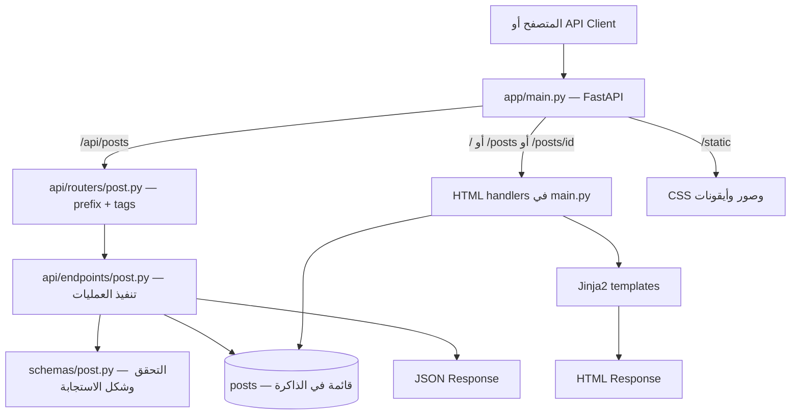

# توثيق مشروع FastAPI Blog والـ Architecture الجديدة

آخر تحديث: 21 أكتوبر 2026. مبني على الملفات الحالية وسجل Git حتى commit `10e66aa`.

## 1. فكرة المشروع وحالته الحالية

المشروع تطبيق مدونة باستخدام Python وFastAPI، بيقدّم واجهتين من نفس التطبيق:

- صفحات HTML بيتم تجهيزها على السيرفر باستخدام Jinja2 لعرض المقالات.
- API بيرجع JSON لقراءة المقالات وإضافة مقال جديد.

البيانات حاليًا محفوظة في قائمة Python داخل الذاكرة. فيه مقالين تجريبيين عند بداية التشغيل، وأي مقالات جديدة بتختفي بعد إعادة تشغيل التطبيق. مفيش قاعدة بيانات شغالة أو نظام مستخدمين لحد دلوقتي.

## 2. اللي اتعمل لحد دلوقتي

| الجزء | اللي اتنفّذ |
| --- | --- |
| تطبيق الويب | إنشاء FastAPI app وربط الـ routes والملفات الثابتة والقوالب |
| الصفحة الرئيسية | عرض كل المقالات على `/` و`/posts` |
| صفحة المقال | عرض مقال حسب رقمه على `/posts/{post_id}`، بعنوان صفحة مأخوذ من أول 50 حرف من عنوان المقال |
| قراءة البيانات | API لعرض كل المقالات أو مقال واحد |
| إنشاء مقال | استقبال JSON والتحقق منه، وتوليد ID وتاريخ تجريبي، ثم إضافة المقال للقائمة |
| التحقق من البيانات | استخدام Pydantic للفصل بين بيانات الإنشاء وبيانات الاستجابة |
| معالجة الأخطاء | JSON لمسارات API وصفحة HTML لباقي المسارات؛ معالجة 404 وأخطاء التحقق 422 |
| الواجهة | Layout مشترك، Bootstrap، CSS مخصص، Navbar، Sidebar، Footer وتصميم متجاوب |
| الثيم | Light وDark وAuto مع حفظ الاختيار في `localStorage` |
| الملفات الثابتة | صورة افتراضية للكاتب، أيقونات، favicon وweb manifest |
| الإعدادات | إنشاء Settings باستخدام `pydantic-settings` وتهيئة قراءة `.env`؛ الربط بالتطبيق لم يُنفّذ بعد |
| تنظيم المشروع | فصل API routers عن endpoints، ونقل schemas والإعدادات لمجلدات مخصصة |
| Git | تجاهل ملفات البيئة والأسرار والكاش والـ virtual environment من خلال `.gitignore` |

أزرار Login وRegister وEdit وDelete موجودة في الواجهة، لكن الوظائف الخلفية الخاصة بيها مش منفّذة.

## 3. الهيكل الحالي للمشروع

```text
fastapi-blog/
├── .gitignore
├── requirements.txt
├── PROJECT_OVERVIEW_AR.md
└── app/
    ├── main.py
    ├── api/
    │   ├── endpoints/
    │   │   ├── __init__.py
    │   │   └── post.py
    │   └── routers/
    │       ├── __init__.py
    │       └── post.py
    ├── core/
    │   ├── __init__.py
    │   ├── settings.py
    │   └── database.py
    ├── schemas/
    │   ├── __init__.py
    │   └── post.py
    ├── models/
    │   └── __init__.py
    ├── utils/
    │   └── __init__.py
    ├── templates/
    │   ├── layout.html
    │   ├── home.html
    │   ├── post.html
    │   └── error.html
    └── static/
        ├── css/main.css
        ├── js/utils.js
        ├── profile_pics/default.jpg
        ├── icons/
        └── site.webmanifest
```

ملفات `__init__.py` بتنظّم المجلدات كـ Python packages. ملف `database.py` وملف `utils.js` فارغين حاليًا، ومجلدا `models` و`utils` مفيهمش تنفيذ فعلي.

## 4. شرح الـ Architecture الجديدة

التطبيق حاليًا تطبيق واحد متقسّم لوحدات حسب المسؤولية. فصل الـ API أصبح أوضح، لكن منطق التنفيذ والتخزين لسه مع بعض في ملف endpoints؛ مفيش طبقة services أو repositories حاليًا.

### `app/main.py`: نقطة تجميع التطبيق

مسؤول عن إنشاء `FastAPI()`، وربط `/static`، وتهيئة Jinja2، وتسجيل router المقالات باستخدام `include_router`.

كمان بيحتوي على مسارات صفحات HTML ومعالجات الأخطاء. بيستورد قائمة `posts` مباشرةً من ملف endpoints، ولذلك صفحات HTML والـ API بيستخدموا نفس القائمة داخل نفس عملية التشغيل.

### `app/api/routers/post.py`: تجميع مسارات المقالات

بيعرّف router بالإعدادات دي:

```python
router = APIRouter(prefix="/api/posts", tags=["Posts"])
router.include_router(post_endpoints)
```

الـ `prefix` بيتضاف للمسارات الموجودة في endpoints، والـ `tags` بتجمعها تحت اسم Posts في توثيق الـ API. الملف ده مسؤول عن تجميع المسارات، مش تنفيذ عمليات المقالات.

### `app/api/endpoints/post.py`: تنفيذ عمليات الـ API

فيه router داخلي ومسارات قراءة المقالات وإنشائها، بالإضافة لقائمة البيانات المؤقتة `posts`.

- `get_posts()` بيرجع القائمة كلها.
- `get_post(post_id)` بيدور على المقال، ولو مش موجود بيرفع `HTTPException` برمز 404.
- `create_post(post)` بيستقبل `PostCreate`، ويحسب رقم جديد، ويضيف المقال للقائمة ويرجعه.

مثلًا المسار `/` في الملف ده مع prefix `/api/posts` بيكوّن المسار النهائي `/api/posts/`.

### `app/schemas/post.py`: شكل البيانات وقواعد التحقق

الـ schema بيحدد البيانات اللي مسموح تدخل والبيانات اللي المفروض ترجع. ده مختلف عن model قاعدة البيانات؛ الـ schema مش جدول ومش بيحفظ البيانات.

| Schema | المسؤولية |
| --- | --- |
| `PostBase` | الحقول المشتركة: العنوان والكاتب والمحتوى مع قيود الأطوال |
| `PostCreate` | يرث `PostBase`، ويمثّل جسم طلب إنشاء المقال |
| `PostResponse` | يرث `PostBase` ويضيف `id` و`date_posted` للاستجابة |

إعداد `from_attributes=True` في `PostResponse` يسمح بقراءة الحقول من خصائص objects عند استخدامها لاحقًا؛ وجوده مش معناه إن ORM أو قاعدة البيانات متوصلين حاليًا.

### `app/core`: الإعدادات والبنية المشتركة

`settings.py` فيه `Settings` مبني على `BaseSettings`، ومجهّز لقراءة `.env` بترميز UTF-8، وبيعمل instance باسم `settings` عند استيراده.

حاليًا الكلاس مفيهوش حقول إعدادات، ومفيش استيراد له في مسار تشغيل التطبيق. كمان `pydantic-settings` مستخدم في الملف لكنه مش مسجّل في `requirements.txt` الحالي.

`database.py` موجود كملف فارغ فقط؛ مفيش engine أو session أو اتصال بقاعدة بيانات.

### `models` و`utils`: أماكن محجوزة للتطوير

`models` مكان مناسب لتعريف ORM models لاحقًا، و`utils` للدوال المساعدة المشتركة. حاليًا مفيش كود فعلي في الاتنين. SQLAlchemy موجود في المتطلبات لكن مش مستخدم في التنفيذ الحالي.

### `templates` و`static`: واجهة المستخدم

| الملف | دوره |
| --- | --- |
| `layout.html` | الهيكل المشترك، المكتبات، التنقل، الشريط الجانبي، الثيم والفوتر |
| `home.html` | يرث layout ويلف على المقالات ويعرض روابط صفحاتها |
| `post.html` | يرث layout ويعرض مقال واحد وأزرار التعديل والحذف ونافذة تأكيد الحذف |
| `error.html` | يرث layout ويعرض رمز الخطأ ورسالته |
| `static/css/main.css` | تنسيق الألوان والخطوط والمقالات والأزرار والاستجابة للشاشات والثيم الداكن |
| `static/js/utils.js` | فارغ؛ كود الثيم حاليًا مكتوب داخل layout |
| `static/site.webmanifest` | اسم التطبيق وألوانه وأيقوناته وإعداد العرض؛ مفيش service worker أو دعم offline منفّذ |

## 5. الطلب بيمشي إزاي؟



في إنشاء مقال: FastAPI بيستخدم `PostCreate` للتحقق من JSON قبل استدعاء `create_post`. لو البيانات صحيحة، الدالة بتضيف المقال للقائمة، وبعدها `PostResponse` بيحدد شكل الاستجابة برمز 201. لو التحقق فشل، معالج الأخطاء بيرجع 422.

في عرض مقال كصفحة: `post_page` بيدور في نفس القائمة، ثم يمرر المقال إلى `post.html`. لو الرقم مش موجود، بيرفع 404 وبيتعرَض `error.html`.

## 6. المسارات الحالية

| Method | المسار | النتيجة |
| --- | --- | --- |
| GET | `/` | HTML لكل المقالات |
| GET | `/posts` | نفس الصفحة الرئيسية |
| GET | `/posts/{post_id}` | HTML لمقال واحد |
| GET | `/api/posts/` | JSON لكل المقالات، 200 |
| GET | `/api/posts/{post_id}` | JSON لمقال واحد، 200 أو 404 |
| POST | `/api/posts/` | إنشاء مقال، 201 أو 422 |
| GET | `/static/...` | ملف ثابت |
| GET | `/docs` | Swagger UI الافتراضية لـ FastAPI |
| GET | `/redoc` | توثيق ReDoc الافتراضي |
| GET | `/openapi.json` | مواصفات الـ API |

مسارات HTML مستبعدة من OpenAPI باستخدام `include_in_schema=False`. مسارا قائمة المقالات والإنشاء متعرّفين بشرطة مائلة أخيرة `/`، فاستخدم الشكل الموضّح في الجدول مباشرةً.

## 7. بيانات المقال وقواعد الإنشاء

| الحقل | النوع | القاعدة |
| --- | --- | --- |
| `title` | string | مطلوب، من 1 إلى 100 حرف |
| `author` | string | مطلوب، من 1 إلى 100 حرف |
| `content` | string | مطلوب، حرف واحد على الأقل |
| `id` | integer | بيولّده السيرفر؛ مش مطلوب في `PostCreate` |
| `date_posted` | string | بيولّده السيرفر؛ مش مطلوب في `PostCreate` |

الـ ID الجديد = أكبر ID موجود + 1، أو 1 لو القائمة فاضية. التاريخ عشوائي بين 1 يناير 2022 و31 ديسمبر 2026، وبيتحوّل لصيغة زي `April 20, 2025`؛ بالتالي مش بيمثّل وقت إنشاء المقال الحقيقي.

التحقق الحالي بيقيس طول النص، ومفيش تنظيف للمسافات أو منع لنص مكوّن من مسافات فقط. اسم الكاتب بيتبعت من العميل؛ مش مأخوذ من هوية مستخدم مسجّل دخوله.

مثال إنشاء مقال:

```bash
curl -X POST http://127.0.0.1:8000/api/posts/ \
  -H 'Content-Type: application/json' \
  -d '{"title":"My first post","author":"Alaa","content":"Learning FastAPI architecture."}'
```

الاستجابة بتحتوي على الحقول الثلاثة بالإضافة للـ ID والتاريخ المُولَّدين. المقال بيظهر بعد كده في GET وفي الصفحة الرئيسية داخل نفس عملية السيرفر.

## 8. معالجة الأخطاء ومسارات القوالب

في `main.py` فيه معالجان:

1. `general_http_exception_handler`: يمسك `StarletteHTTPException`، ومنها خطأ المقال غير الموجود. لو المسار بيبدأ بـ `/api`، يرجع JSON فيه `detail`؛ غير كده يعرض `error.html` بنفس رمز الخطأ.
2. `validation_exception_handler`: يمسك `RequestValidationError` ويرجع 422. الـ API بيرجع تفاصيل التحقق، والصفحة بتعرض رسالة `Invalid request.`.

أمثلة: `/posts/999` يرجع صفحة 404 لو المقال مش موجود، و`/posts/abc` يرجع صفحة 422 لأن `post_id` لازم يكون integer. نفس الفكرة لمسارات API لكن بصيغة JSON.

مشكلة `TemplateNotFound` السابقة كانت ناتجة عن عدم توافق مجلد البحث مع أسماء القوالب. الوضع الحالي الصحيح في الكود:

```python
templates = Jinja2Templates(directory="app/templates")
# أسماء القوالب بالنسبة لمجلد البحث:
# "home.html", "post.html", "error.html"
```

والوراثة داخل القوالب بتستخدم ``. إضافة `templates/` للاسم بتخلّي Jinja يبحث عن مجلد إضافي داخل مجلد القوالب.

المسارات الحالية `app/templates` و`app/static` نسبية لمجلد تشغيل الأمر، لذلك شغّل التطبيق من جذر المشروع. النسخة الحالية مش بتستخدم مسارات مطلقة مبنية على `__file__`.

## 9. التشغيل المحلي

نفّذ الأوامر من مجلد `fastapi-blog`:

```bash
python -m venv .venv
source .venv/bin/activate
python -m pip install -r requirements.txt
python -m uvicorn app.main:app --reload
```

لو البيئة `.venv` موجودة بالفعل، يكفي تفعيلها وتثبيت المتطلبات عند الحاجة. افتح `http://127.0.0.1:8000/` للواجهة، أو `http://127.0.0.1:8000/docs` لتجربة الـ API.

الحزم الأساسية المسجلة تشمل FastAPI وUvicorn وJinja2 وPydantic وSQLAlchemy. الاعتماد `pydantic-settings` ناقص من ملف المتطلبات؛ لازم إضافته وتثبيته عند تفعيل وحدة settings. ملف `.env` متجاهَل في Git، و`.env.example` مسموح بتتبعه حسب `.gitignore` لكنه غير موجود حاليًا. لا يوجد توثيق هنا لأي قيم سرية.

## 10. إيه اللي اتغيّر في إعادة التنظيم؟

| قبل إعادة التنظيم | بعد إعادة التنظيم |
| --- | --- |
| منطق API المقالات داخل `main.py` | انتقل إلى `api/endpoints/post.py` |
| مسارات API ضمن الملف الرئيسي | router مستقل في `api/routers/post.py`، ويتسجّل من `main.py` |
| قائمة المقالات في الملف الرئيسي | موجودة في endpoints والملف الرئيسي بيستوردها |
| `app/schemas.py` | `app/schemas/post.py` داخل package |
| `app/config.py` | `app/core/settings.py` |
| مفيش أماكن مخصصة لباقي الطبقات | إضافة `core/database.py` ومجلدي `models` و`utils` كهيكل مبدئي |

الفائدة إن كل جزء بقى له مكان أوضح، وإضافة موارد جديدة زي users ممكن تتبع نفس التنظيم. لكن الفصل لسه جزئي: الواجهة بتعتمد مباشرةً على بيانات endpoints، ومنطق البحث عن مقال متكرر في HTML والـ API.

## 11. مراحل التطوير حسب سجل Git

| Commit | المرحلة |
| --- | --- |
| `44817cc` | إضافة المحتوى والملفات الثابتة |
| `36978b4` | إضافة صفحة المقال |
| `4b5d794` | إضافة معالج الأخطاء |
| `c1dacf3` | إضافة Pydantic schemas |
| `d126f24` | توليد تاريخ عشوائي عند إنشاء مقال |
| `3adf5f5` | إضافة إعدادات `.env` باستخدام pydantic-settings |
| `10e66aa` | إعادة تنظيم معمارية المشروع بالشكل الحالي |

الجدول بيلخص commits التطوير الأساسية؛ تم حذف merge commits من العرض لتجنب تكرار نفس المراحل.

## 12. الحدود الحالية والخطوات اللي لسه متعملتش

| الجزء | الحالة الحالية / المطلوب لاحقًا |
| --- | --- |
| حفظ دائم | مفيش؛ محتاج توصيل قاعدة بيانات وتعريف models وsessions وmigrations |
| فصل منطق العمل | مفيش services أو repositories؛ ممكن إضافتها لتوحيد منطق HTML والـ API |
| تسجيل الدخول | مفيش تسجيل مستخدمين أو تحقق من الهوية أو جلسات أو tokens |
| الصلاحيات | مفيش تحقق من صاحب المقال؛ أزرار التعديل والحذف ظاهرة بدون شرط فعلي |
| التعديل والحذف | مفيش PUT/PATCH/DELETE؛ زر Edit يشير إلى `#` وفورم الحذف غير مربوط بعملية حذف |
| إضافة مقال من الواجهة | الإنشاء متاح عبر API فقط؛ مفيش صفحة أو فورم إنشاء |
| صحة التاريخ | تاريخ تجريبي عشوائي؛ محتاج تاريخ إنشاء حقيقي لو ده السلوك المطلوب |
| التزامن والتوسّع | كل process عنده قائمة مستقلة؛ توليد IDs والقائمة الحالية مش بديل لتخزين يدعم التزامن |
| البحث والتصفح | مفيش بحث أو pagination أو فلترة أو ترتيب صريح |
| الإعدادات | تعريف الحقول المطلوبة، إضافة الاعتماد الناقص، ثم ربط settings بالتطبيق |
| الاختبارات | مفيش ملفات اختبارات آلية متتبعة في المشروع الحالي |
| التشغيل والنشر | مفيش إعداد Docker أو CI/CD ضمن الملفات الحالية |

التوثيق ده بيصف الكود الموجود، والخطوات المستقبلية في القسم الأخير مقترحات وليست وظائف منفّذة. تم إعداد الملف بمراجعة المصدر وسجل Git؛ لم يتم تشغيل اختبارات جديدة ضمن مهمة التوثيق.
