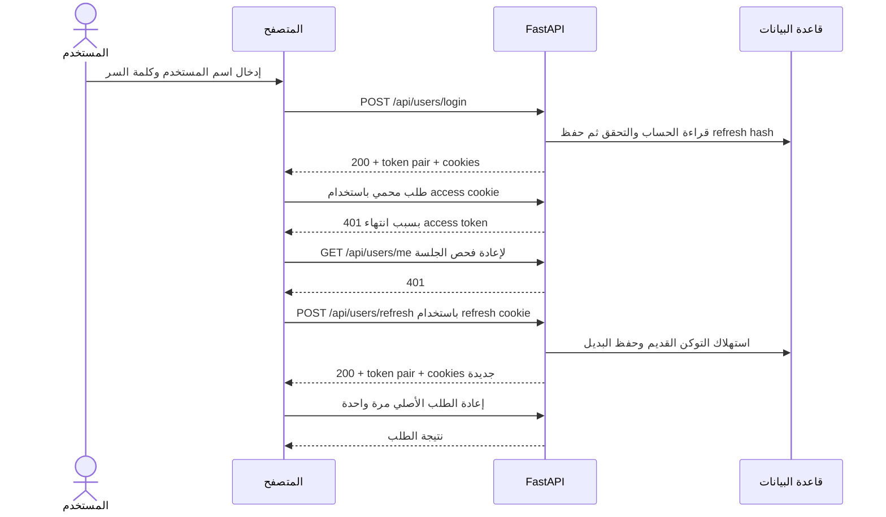

# شرح Authentication Flow الحالي في Awesome Blog

التطبيق بيستخدم **Access Token من نوع JWT** لإثبات هوية المستخدم في الطلبات المحمية، و**Refresh Token عشوائي** لإصدار توكنات جديدة من غير إدخال كلمة السر كل مرة. المتصفح بيجدد الجلسة تلقائيًا عند رجوع `401`، طالما الـRefresh Token ما زال صالحًا.

الإعدادات الافتراضية هي 30 دقيقة للـAccess Token، و7 أيام للجلسة من وقت تسجيل الدخول. التجديد بيغيّر التوكنات، لكنه بيحتفظ بموعد انتهاء الجلسة الأصلي. بعد الموعد ده، المستخدم لازم يعمل Login جديد.

## الفرق بين التوكنات والجلسة

| العنصر | دوره في التنفيذ الحالي |
| --- | --- |
| Access Token | JWT موقّع بـ`HS256`، بيتبعت مع الطلبات المحمية. |
| Refresh Token | قيمة عشوائية من `secrets.token_urlsafe(48)`، تُستخدم مرة واحدة لتجديد التوكنات. ليست JWT. |
| Session | سلسلة التوكنات الناتجة عن Login واحد، وكلها مرتبطة بنفس `session_id`. |
| Authentication | التأكد من هوية المستخدم داخل `get_current_user()`. |
| Authorization | التأكد إن المستخدم له حق تنفيذ العملية، مثل تعديل بوست يملكه. |

التنفيذ بيعتمد على قاعدة البيانات مع كل طلب محمي: بيتحقق من إلغاء الـAccess Token، ومن حالة الجلسة، ومن الحساب الحالي. توقيع JWT الصحيح وحده مش كفاية للسماح بالطلب.

## المسار العام في المتصفح



الرسم بيوضح حالة نجاح التجديد. لو الـRefresh Token انتهى أو اتلغى، `/refresh` بيرجع `401`، والواجهة بتتحول لحالة المستخدم غير المسجل.

## إنشاء الحساب وتسجيل الدخول

### إنشاء الحساب

`POST /api/users/register` بيتحقق من بيانات التسجيل ومن وجود اسم المستخدم أو البريد بالفعل، ثم بيخزن كلمة السر بعد عمل hash باستخدام `bcrypt`. بيرجع بيانات الحساب مع `201`، من غير إنشاء جلسة دخول. الواجهة بعدها بتفتح نموذج Login.

عمليات حساب كلمة السر والتحقق منها بتشتغل من خلال `run_in_threadpool` عشان ما تعطلش الـevent loop.

### تسجيل الدخول

عند استدعاء `POST /api/users/login`:

1. `check_origin()` بيفحص هيدر `Origin` لو موجود.
2. `login_user()` بيبحث عن الحساب بالـusername، ويتحقق من كلمة السر باستخدام `verify_password()`.
3. لو البيانات غلط، بيرجع `401` برسالة `Incorrect username or password`.
4. عند النجاح، `start_login()` بيلغي التوكنات والجلسات القديمة اللي يقدر يتعرف عليها من بيانات الدخول المرسلة مع نفس الطلب.
5. بينشئ `session_id` جديد، ويحدد انتهاء الجلسة بعد `REFRESH_TOKEN_DAYS`.
6. `issue_token_pair()` بينشئ Access Token وRefresh Token، ويحفظ SHA-256 hash للـRefresh Token في قاعدة البيانات.
7. بعد نجاح الـcommit، الرد بيرجع التوكنين وبيحطهما في Cookies، مع `Cache-Control: no-store`.

الدخول من جهاز جديد من غير إرسال توكنات الجهاز القديم ما بيلغيش جلسات الجهاز القديم تلقائيًا.

رد Login بيحتوي على `access_token` و`refresh_token` و`token_type` و`expires_in` و`refresh_expires_in`، بالإضافة إلى `message` وبيانات المستخدم: `id` و`username` و`email` و`image_file` و`image_path`. مدد الصلاحية في الرد بالثواني.

## إرسال التوكنات والـCookies

| Cookie | المحتوى | مدة البقاء |
| --- | --- | --- |
| `blog_session` | Access Token | `expires_in`، وافتراضيًا 1800 ثانية عند الإصدار. |
| `blog_refresh` | Refresh Token | الوقت المتبقي حتى موعد انتهاء الجلسة الأصلي. |

الاتنين عليهم `HttpOnly` و`SameSite=lax` و`Path=/`. خاصية `Secure` بتتفعّل لما `request.url.scheme` يكون `https`. `HttpOnly` بيمنع قراءة الـCookie مباشرةً من JavaScript؛ Login وRefresh بيرجعوا التوكنات أيضًا في JSON لدعم عملاء الـAPI.

واجهة التطبيق بتستخدم `fetch` مع `credentials: "same-origin"`، فالمتصفح بيبعت الـCookies تلقائيًا. الكود الحالي ما بيخزنش التوكنات في `localStorage`.

عميل API يقدر يستخدم:

```http
Authorization: Bearer <access_token>
```

**هيدر Authorization له الأولوية على access cookie.** لو الهيدر موجود لكنه غير صالح، التطبيق ما بيرجعش يستخدم الـCookie الصالحة بدلًا منه. في `/refresh`، قيمة `refresh_token` داخل JSON لها الأولوية على refresh cookie.

## التحقق من الطلب المحمي

أي endpoint فيه `Depends(get_current_user)` بيمر بالتحقق قبل تنفيذ جسم دالة الـendpoint. مثال إنشاء بوست:

```python
current_user: User = Depends(get_current_user)
```

`get_current_user()` بيعمل الخطوات التالية:

1. بيفحص `Origin` للطلبات التي تغيّر البيانات؛ الفحص هنا لا يشمل `GET` و`HEAD` و`OPTIONS`.
2. بيستخرج Access Token من Bearer header أو `blog_session`.
3. `decode_access_token()` بيتحقق من التوقيع والخوارزمية والـissuer والـaudience والتوقيتات والحقول المطلوبة.
4. بيتأكد إن `jti` مش موجود في `revoked_tokens`.
5. لو التوكن فيه `sid`، بيبحث عن Refresh Token لنفس الجلسة والمستخدم، يكون غير مستخدم وغير ملغى ولسه صالحًا.
6. بيقرأ المستخدم ويتأكد إن الحساب موجود وإن `ver` ما زال مطابقًا لكلمة السر المخزنة حاليًا.
7. بيرجع كائن `User` للـendpoint.

| حقل JWT | معناه |
| --- | --- |
| `sub` | رقم المستخدم كنص. |
| `sid` | معرّف الجلسة المرتبطة بتوكنات التجديد. |
| `jti` | معرّف عشوائي للـAccess Token نفسه. |
| `ver` | HMAC مشتق من password hash ومفتاح التطبيق، لربط التوكن بنسخة كلمة السر الحالية. |
| `iat` | وقت الإصدار. |
| `nbf` | الوقت الذي يبدأ عنده قبول التوكن. |
| `exp` | وقت انتهاء التوكن. |
| `iss` | القيمة الثابتة `awesome-blog`. |
| `aud` | القيمة الثابتة `awesome-blog-api`. |

التوكنات الأقدم، الصادرة قبل إضافة Refresh Token، ممكن تتقبل من غير `sid` لحد انتهاء صلاحيتها إذا نجحت بقية الفحوص. تسجيل الدخول مرة جديدة هو اللي بيدي المستخدم جلسة تدعم التجديد.

فشل المصادقة بيرجع `401` مع `WWW-Authenticate: Bearer` والجسم التالي:

```json
{"detail": "Please log in to continue"}
```

## انتهاء Access Token والتجديد التلقائي

### سلوك الواجهة

عند تحميل الصفحة، `app.js` بيطلب `/api/users/me` لمعرفة المستخدم الحالي. الطلب ده، وباقي الطلبات من خلال `api()`، بيمروا بمنطق التجديد في `api.js`.

عند رجوع `401`:

1. لو طلب آخر في نفس الصفحة جدّد الجلسة بالفعل، الواجهة بتعيد الطلب باستخدام الـCookies الجديدة.
2. غير كده، بتشترك الطلبات المتزامنة في Promise واحدة للتجديد اسمها `refreshing`.
3. الواجهة بتعيد فحص `/api/users/me` قبل التجديد، لأن tab تانية ممكن تكون حدّثت الـCookies المشتركة بالفعل.
4. لو إعادة الفحص رجعت `401`، بتطلب `POST /api/users/refresh` من غير body، اعتمادًا على الـCookie.
5. لو التجديد نجح، بتعيد الطلب الأصلي **مرة واحدة فقط** بنفس method وbody، بما في ذلك `FormData` لرفع الصور.
6. لو التجديد رجع `401`، أو الطلب المعاد رجع `401`، بتستدعي `updateUser(null)` لإظهار واجهة المستخدم غير المسجل.

مسارات Login وRegister وRefresh وLogout مستثناة من التجديد التلقائي. كمان `403` ما بيبدأش محاولة Refresh.

في المتصفحات التي تدعم Web Locks، القفل `blog-session-refresh` بينسق التجديد بين الـtabs. من غير الدعم ده، مشاركة Promise بتنسق الطلبات داخل الصفحة الواحدة فقط؛ استخدام نفس Refresh Token بالتزامن من tabs مختلفة ممكن يُعامل كإعادة استخدام ويلغي الجلسة.

فشل الشبكة أو خطأ مؤقت في التجديد بيطلع رسالة خطأ من `api.js` من غير استدعاء `onUnauthorized`. عند تحميل الصفحة أول مرة، معالج فشل `sessionReady` في `app.js` بيضبط الواجهة على المستخدم غير المسجل حتى لو السبب مشكلة اتصال.

مفيش timer بيجدد التوكن في الخلفية أو يعمل Logout لحظة انتهاء الوقت. السلوك بيتحدد عند الطلب التالي؛ صفحة مفتوحة من غير طلبات ممكن تفضل ظاهرة كأن المستخدم مسجل.

### سلوك السيرفر عند Refresh

`POST /api/users/refresh` بيستخدم Refresh Token نفسه، ومش محتاج Access Token صالحًا:

1. بيحسب hash للتوكن وبيبحث عن سجله في `refresh_tokens`.
2. بيعمل تحديثًا مشروطًا في قاعدة البيانات: `used=True` فقط لو التوكن غير مستخدم، وغير ملغى، ولم تنتهِ صلاحيته.
3. بيتحقق من وجود المستخدم وتطابق `credential_version` مع كلمة السر الحالية.
4. بيصدر زوج توكنات جديدًا بنفس `session_id` ونفس `expires_at` للجلسة.
5. بيحفظ التغيير ويرجع التوكنين والـCookies الجديدة. رد Refresh بيحتوي على حقول التوكنات الخمسة فقط، من غير بيانات المستخدم.

الـRefresh Token القديم بيُحتفظ بسجله بعد استخدامه لكشف إعادة الاستخدام. لو اتبعت تاني، السيرفر بيلغي كل توكنات التجديد المرتبطة بنفس الجلسة، ويرجع `401`. ونتيجة فحص `sid` في الطلبات المحمية، الـAccess Tokens المرتبطة بالجلسة دي بتترفض أيضًا.

**التجديد الناجح وحده ما بيلغيش الـAccess Token السابق فورًا.** يفضل صالحًا لحد انتهاء `exp`، طالما الجلسة والحساب صالحين والتوكن لم يُلغَ. اللي بيتم استهلاكه مرة واحدة هو الـRefresh Token.

مثال للمدة الافتراضية: لو حصل Login الآن، فالـAccess Token ينتهي بعد 30 دقيقة والجلسة بعد 7 أيام. Refresh بعد ساعة بيدي Access Token جديدًا لمدة 30 دقيقة، لكن موعد انتهاء الجلسة يفضل بعد 7 أيام من الدخول الأول. ولو الجلسة انتهت، فحص `sid` بيرفض الوصول حتى لو `exp` في آخر Access Token لسه ما انتهتش.

## تسجيل الخروج وتغيير كلمة السر وحذف الحساب

| الحدث | التأثير الحالي |
| --- | --- |
| Logout | يلغي الجلسات التي يتعرف عليها من التوكنات المرسلة، ويسجل `jti` للـAccess Tokens الصالحة المرسلة في قائمة الإلغاء، ثم يمسح الـCookies ويرجع `204`. |
| Login جديد | يلغي التوكنات والجلسات القديمة المعروفة من الطلب نفسه، ويبدأ جلسة مستقلة بموعد انتهاء جديد. |
| تغيير كلمة السر | يعلّم كل Refresh Tokens الخاصة بالمستخدم بأنها ملغاة؛ تغيير `ver` يبطل الـAccess Tokens السابقة أيضًا. يلزم Login جديد. |
| حذف الحساب | يحذف Refresh Tokens الخاصة بالمستخدم والحساب وبوستاته، ويمسح الـCookies. غياب الحساب يمنع قبول توكناته. |
| إعادة استخدام Refresh Token | تلغي الجلسة المرتبطة به، بما فيها إمكانية استخدام الـAccess Tokens التابعة لها. |

`POST /api/users/logout` مش بيعتمد على `get_current_user()`، لذلك يقدر ينهي الجلسة باستخدام refresh cookie حتى لو access cookie انتهت واختفت. لو عميل API ما بيستخدمش Cookies والـAccess Token انتهى، لازم يبعت `refresh_token` في JSON عشان السيرفر يحدد الجلسة ويلغيها. إرسال Access Token منتهي وحده لا يكفي لإلغاء جلسة التجديد.

Logout من جلسة واحدة ما بيلغيش كل جلسات الحساب على الأجهزة الأخرى. لو الطلب بعت توكنات من أكتر من جلسة عبر الهيدر والـCookies والـbody، الجلسات التي تم التعرف عليها منها تتلغى.

عند الدخول والخروج، `revoke_request_tokens()` بتنظف سجلات `revoked_tokens` و`refresh_tokens` المنتهية. الدالة دي بتُستخدم أيضًا أثناء حذف الحساب؛ التنظيف مش background job مستقل.

## الصلاحيات على الـEndpoints

| المسار | متطلبات الوصول |
| --- | --- |
| `POST /api/users/register` و`POST /api/users/login` | لا يحتاجان جلسة سابقة؛ فحص Origin مفعّل. |
| `POST /api/users/refresh` | Refresh Token صالح، مع فحص Origin. |
| `POST /api/users/logout` | لا يشترط Access Token صالحًا؛ يُلغي بيانات الدخول المعروفة من الطلب، مع فحص Origin. |
| `GET /api/users/me` | Access Token صالح. |
| `PUT /api/users/me/image` و`DELETE /api/users/me/image` | Access Token صالح؛ الصورة تخص المستخدم الحالي. |
| `PATCH /api/users/{user_id}/update` و`DELETE /api/users/{user_id}/delete` | المستخدم الحالي لازم يكون صاحب الحساب. |
| `POST /api/posts/` | مستخدم مسجل؛ الكاتب يُحدد من `current_user.id`. |
| `PATCH /api/posts/{post_id}` و`DELETE /api/posts/{post_id}` | مستخدم مسجل وصاحب البوست. |
| `GET /api/posts/` و`GET /api/posts/{post_id}` | متاحان بدون تسجيل دخول. |
| `GET /api/users/{user_id}/posts` و`GET /api/users/{user_id}/profile` | متاحان بدون تسجيل دخول. |

في `post.py`، بعد نجاح المصادقة، التعديل والحذف بيقارنا `post.user_id` مع `current_user.id`. إرسال `user_id` من العميل ما بيديش صلاحية تعديل بوست مستخدم آخر.

`401` معناه إن بيانات المصادقة غير مقبولة. `403` ممكن يعني إن المستخدم مش صاحب المورد، أو إن فحص Origin رفض الطلب. `404` بيرجع لو المورد غير موجود بعد الوصول لفحصه، و`422` معناه إن شكل البيانات غير مطابق للـschema.

فحص Origin الحالي بيرفض الطلب لو الهيدر موجود ومختلف عن `scheme://netloc` الخاص بالطلب. غياب الهيدر وحده مش سبب للرفض، وده يسمح لعملاء API مثل CLI باستخدام المسارات.

## أمثلة لعميل API بدون Cookies

الأمثلة بتفترض وجود الحساب. أسماء التوكنات بين `< >` أماكن لقيم ترجع من السيرفر.

تسجيل الدخول:

```http
POST /api/users/login
Content-Type: application/json

{"username": "alice", "password": "Password1"}
```

استخدام Access Token من الرد:

```http
POST /api/posts/
Authorization: Bearer <access_token>
Content-Type: application/json

{"title": "My post", "content": "Post content"}
```

عند انتهاء التوكن، طلب التجديد:

```http
POST /api/users/refresh
Content-Type: application/json

{"refresh_token": "<current_refresh_token>"}
```

بعد النجاح، العميل يستبدل **التوكنين** بالقيم الجديدة، ثم يعيد الطلب الأصلي مرة واحدة. إرسال Refresh Token قديم بعد كده يلغي الجلسة. التجديد التلقائي موجود في واجهة التطبيق؛ عميل API مستقل لازم ينفذ الخطوات دي بنفسه.

تسجيل الخروج، حتى لو الـAccess Token انتهى:

```http
POST /api/users/logout
Content-Type: application/json

{"refresh_token": "<latest_refresh_token>"}
```

في المتصفح، Refresh وLogout ممكن يتبعتوا بدون body، لأن الـCookies بتحتوي على التوكنات. لو بعت JSON فيه `refresh_token`، الـschema بيشترط نصًا بطول من 1 إلى 256 حرفًا؛ البيانات غير المطابقة بترجع `422` قبل فحص صلاحية التوكن.

## الإعدادات والتخزين

| الإعداد | القيمة الافتراضية والحدود |
| --- | --- |
| `JWT_SECRET_KEY` | مطلوب، بطول 32 حرفًا على الأقل؛ لا توجد قيمة افتراضية. |
| `JWT_ACCESS_TOKEN_MINUTES` | 30 دقيقة؛ من 1 إلى 10080 دقيقة. |
| `REFRESH_TOKEN_DAYS` | 7 أيام؛ من 1 إلى 90 يومًا. |

القيم موجودة في [settings.py](../app/core/settings.py)، ومثال الضبط في [.env.example](../.env.example). تغيير `JWT_SECRET_KEY` يبطل توقيعات الـAccess Tokens السابقة، ويغيّر قيمة بصمة كلمة السر المحسوبة عند التحقق من Refresh Tokens.

مع تغيير اسم المشروع، أصبحت قيم `iss` و`aud` هي `awesome-blog` و`awesome-blog-api`. التوكنات الصادرة بالاسم السابق لم تعد صالحة، ويلزم تسجيل الدخول مجددًا.

جدول `refresh_tokens` بيحتوي على `token_hash` و`session_id` و`user_id` و`credential_version` و`expires_at` و`used` و`revoked`. القيمة الأصلية للـRefresh Token لا تُحفظ فيه. جدول `revoked_tokens` بيحتوي على `jti` و`expires_at` للـAccess Tokens الملغاة.

جداول `users` و`posts` و`refresh_tokens` و`revoked_tokens` تُدار عبر Alembic. عند تشغيل Compose، خدمة `migrate` تطبق `alembic upgrade head` قبل بدء التطبيق؛ لم يعد بدء التطبيق ينشئ الجداول تلقائيًا. بعد نشر مخطط جديد، قاعدة البيانات تُحدّث بالمهاجرة قبل استقبال الطلبات.

## الملفات والاختبارات

| الملف | مسؤوليته |
| --- | --- |
| [auth.py](../app/core/auth.py) | إصدار وفحص وإلغاء التوكنات، إدارة الـCookies، و`get_current_user`. |
| [security.py](../app/core/security.py) | حساب password hash والتحقق منه باستخدام bcrypt. |
| [user.py](../app/api/endpoints/user.py) | مسارات Register وLogin وRefresh وLogout وإدارة الحساب. |
| [post.py](../app/api/endpoints/post.py) | حماية إنشاء البوست والتحقق من ملكيته عند التعديل والحذف. |
| [refresh_token.py](../app/models/refresh_token.py) | نموذج التخزين الخاص بتوكنات التجديد. |
| [revoked_token.py](../app/models/revoked_token.py) | نموذج قائمة إلغاء Access Tokens. |
| [api.js](../app/static/js/api.js) | التجديد التلقائي، مشاركة محاولة التجديد، وإعادة الطلب مرة واحدة. |
| [app.js](../app/static/js/app.js) | نماذج الدخول والخروج وتحديث واجهة المستخدم الحالي. |
| [test_async_app.py](../tests/test_async_app.py) | اختبارات الـAPI وقاعدة البيانات، ومنها انتهاء التوكنات والتجديد والإلغاء والصلاحيات. |
| [test_api.mjs](../tests/test_api.mjs) | اختبارات عميل JavaScript، ومنها الطلبات المتزامنة وإعادة المحاولة وفشل التجديد. |

لتشغيل الاختبارات من مجلد المشروع:

```bash
.venv/bin/python -m unittest discover -s tests -q
node --test tests/test_api.mjs
```
