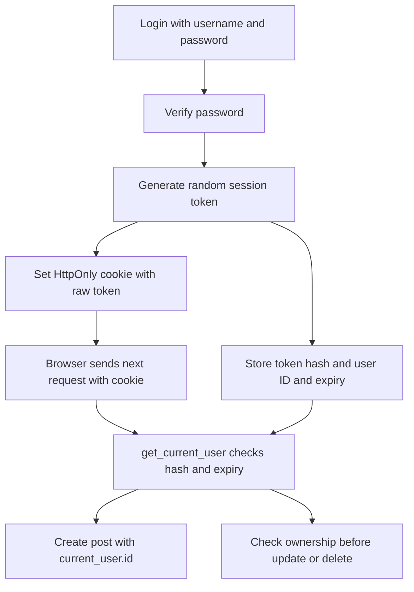

# شرح تغييرات الباك إند سطرًا بسطر

شرح التنفيذ الحالي بعد إضافة Refresh Tokens موجود في [شرح Authentication Flow الحالي](AUTHENTICATION_FLOW_AR.md). الأقسام التالية توثيق تاريخي؛ وصف عدم وجود Refresh Token وعدم إنشاء سجل عند إصدار التوكن يخص النسخة السابقة.

## تحديث 27 أكتوبر 2026 عن المصادقة باستخدام JWT قبل إضافة Refresh Tokens

استُبدلت جلسات `LoginSession` بتوكنات JWT موقعة باستخدام `PyJWT` وخوارزمية `HS256` ثابتة. الأقسام القديمة بعد هذا التحديث توثيق تاريخي لتنفيذ الجلسات السابق، وأرقام أسطرها لا تصف النسخة الحالية.

- `POST /api/users/login` يرجع `access_token` و`token_type: bearer` و`expires_in` بجانب بيانات المستخدم، ويضع نفس التوكن في Cookie باسم `blog_session`. رد الدخول يحمل `Cache-Control: no-store`.
- المتصفح يستمر باستخدام Cookie من نوع `HttpOnly` و`SameSite=lax`، مع `Secure` على HTTPS. عميل الـAPI يستطيع إرسال `Authorization: Bearer <access_token>`؛ الهيدر له الأولوية على الـCookie، حتى لو كان غير صالح. زر Authorize في Swagger يدعم Bearer.
- التوكن يحتوي `sub` لرقم المستخدم و`jti` عشوائيًا و`iat` و`nbf` و`exp` و`iss` و`aud`. التحقق يلزم هذه الحقول ويرفض التوقيع غير الصحيح والخوارزميات الأخرى والتوكن المنتهي أو المبكر أو الموجه لتطبيق آخر.
- حقل `ver` يحتوي HMAC لبصمة كلمة السر المخزنة، وليس كلمة السر أو بصمتها الأصلية. يُقارَن بالحساب الحالي، فيبطل التوكن بعد تغيير كلمة السر، ويمنع توكن حساب محذوف من الدخول لحساب جديد لو SQLite أعادت استخدام نفس الرقم. بعد تغيير كلمة السر يلزم تسجيل الدخول مجددًا.
- لا يتم إنشاء سجل جلسة عند إصدار التوكن. موديل `RevokedToken` في `app/models/revoked_token.py` يخزن فقط `jti` ووقت الانتهاء للتوكنات الملغاة. كل طلب محمي يتحقق من التوقيع ثم قائمة الإلغاء والحساب الحالي؛ التنفيذ يحتفظ بهذا القدر من حالة السيرفر لضمان الخروج الفوري.
- Logout يلغي التوكن المرسل ويحذف الـCookie. Login جديد يلغي التوكن السابق المرسل مع نفس الطلب. عند إرسال هيدر وCookie معًا، يُلغى الاثنان. التوكنات الخاصة بأجهزة مستقلة لا تُلغى بمجرد الخروج من جهاز واحد. سجلات الإلغاء المنتهية تُنظف عند الدخول والخروج.
- فحص origin وصلاحيات ملكية الحسابات والبوستات مستمران كما كانا.

الإعدادات في `app/core/settings.py`:

| المتغير | الإعداد |
| --- | --- |
| `JWT_SECRET_KEY` | مطلوب، 32 حرفًا على الأقل؛ استخدم قيمة عشوائية خاصة وثابتة مشتركة بين عمليات التطبيق |
| `JWT_ACCESS_TOKEN_MINUTES` | الافتراضي 30 دقيقة؛ يمكن ضبطه بين دقيقة و10080 دقيقة |

ملف `.env.example` يوضح المتغيرات. لتوليد مفتاح محلي: `python -c "import secrets; print(secrets.token_urlsafe(32))"`، ثم ضعه في `.env` غير المتتبع في Git. لا يوجد مفتاح افتراضي داخل الكود، وتغيير المفتاح يبطل التوكنات السابقة. ثبّت المتطلبات باستخدام `python -m pip install -r requirements.txt`.

دورة بدء التطبيق تنشئ جدول `revoked_tokens` تلقائيًا. قواعد البيانات القديمة قد تحتفظ بجدول `login_sessions`؛ هذا التحديث لا يحذف بياناته ولا يستخدمها للمصادقة. الـCookies القديمة لا تُقبل كتوكينات JWT، لذلك المستخدمون الحاليون يحتاجون تسجيل دخول جديد. لا يوجد refresh token تلقائي؛ بعد انتهاء المدة يلزم Login جديد.

الاختبارات تعمل على قاعدة مؤقتة بمفتاح خاص بالاختبار وتشمل Cookie وBearer والتوقيع والـclaims ومدة الصلاحية والإلغاء وتغيير كلمة السر وإعادة استخدام أرقام الحسابات.

مرجع المكتبة: [PyJWT usage](https://pyjwt.readthedocs.io/en/latest/usage.html).

## التوثيق التاريخي قبل JWT

الإضافات الأساسية هي جلسة دخول محفوظة في قاعدة البيانات، وتحديد صاحب البوست من هذه الجلسة، والتحقق من صلاحية التعديل والحذف. بعد ذلك اتفصلت مسارات الصفحات ودورة الحياة ومعالجة الأخطاء عن `main.py` ليبقى مسؤولًا عن تركيب التطبيق فقط.

النطاق هنا هو تغييرات الباك إند التي عملتها في هذه المحادثة، ومعها تغييرات اختبارات الباك إند. JavaScript وHTML وCSS خارج النطاق؛ مفيش تعديل جديد على كود التطبيق ضمن كتابة الشرح.

**نسخة الشرح:** 26 أكتوبر 2026. أرقام الأسطر تخص الملفات الحالية وقت كتابة المستند، وقد تتحرك لو عدّلت الكود بعد كده. الأسطر الفارغة للتنسيق فقط، لذلك مش مكررة في جداول الشرح. أسطر الأقواس والإغلاق غير الفارغة مذكورة ضمن الشرح. ملفات النقل موضحة بصفتها نقلًا، وليس كأن كل منطقها اتكتب جديد.

## دليل القراءة

- [1 جدول جلسات تسجيل الدخول](#1-جدول-جلسات-تسجيل-الدخول)
- [2 التحقق من الجلسة وإنشاؤها وإلغاؤها](#2-التحقق-من-الجلسة-وإنشاؤها-وإلغاؤها)
- [3 تعديل مسارات المستخدمين](#3-تعديل-مسارات-المستخدمين)
- [4 تعديل إنشاء البوست وتعديله وحذفه](#4-تعديل-إنشاء-البوست-وتعديله-وحذفه)
- [5 تعديل شكل بيانات إنشاء البوست](#5-تعديل-شكل-بيانات-إنشاء-البوست)
- [6 ملف تشغيل التطبيق بعد التنظيف](#6-ملف-تشغيل-التطبيق-بعد-التنظيف)
- [7 بدء التطبيق وإغلاقه](#7-بدء-التطبيق-وإغلاقه)
- [8 مشاركة إعداد القوالب](#8-مشاركة-إعداد-القوالب)
- [9 مسارات صفحات HTML بعد نقلها](#9-مسارات-صفحات-html-بعد-نقلها)
- [10 معالجة أخطاء الـAPI والصفحات](#10-معالجة-أخطاء-الـapi-والصفحات)
- [11 الاختبارات التي اتضافت واتعدلت](#11-الاختبارات-التي-اتضافت-واتعدلت)

## خريطة الملفات

| الملف | نوع التغيير | السبب |
| --- | --- | --- |
| `app/models/session.py` | جديد | تخزين جلسة الدخول وربطها بالمستخدم ووقت الانتهاء |
| `app/core/auth.py` | جديد | إنشاء الجلسة والتحقق منها وإلغاؤها وفحص origin |
| `app/api/endpoints/user.py` | تعديل | ربط Login بالجلسة وإضافة Me وLogout وحماية تعديل وحذف الحساب |
| `app/api/endpoints/post.py` | تعديل | تحديد الكاتب والتحقق من الملكية من الجلسة |
| `app/schemas/post.py` | تعديل | إزالة `user_id` من مدخلات إنشاء البوست |
| `app/main.py` | إعادة تنظيم | الاكتفاء بتجميع التطبيق وربط الـrouters |
| `app/core/lifespan.py` | نقل مع تعديل الوصول للمحرك | بدء قاعدة البيانات وإغلاق مواردها |
| `app/web/templates.py` | نقل | مشاركة إعداد Jinja بين الصفحات والأخطاء |
| `app/web/__init__.py` | جديد وفارغ | تعريف حزمة Python للصفحات |
| `app/web/routes.py` | نقل وتنظيم | وضع مسارات HTML في router مستقل |
| `app/core/exceptions.py` | نقل وتنظيم | مشاركة تسجيل معالجات HTTP وvalidation |
| `tests/test_async_app.py` | تعديل وإضافة | اختبار الجلسات والصلاحيات والحفاظ على الاختبارات القديمة |

ما اتغيّرش في هذه المحادثة: `app/core/database.py`، و`app/core/security.py`، وموديلات `User` و`Post`، و`app/schemas/user.py`، وملفات router بادئات الـAPI، و`requirements.txt`. كون الكود الجديد يستورد منها لا يعني إن محتواها اتعدل. تحويل المشروع إلى async كان موجودًا قبل هذه المحادثة، وله شرح منفصل في [ASYNC_MIGRATION.md](ASYNC_MIGRATION.md).

## إزاي الطلب بقى يعرف مين صاحبه

1. المستخدم يرسل اسم المستخدم وكلمة السر إلى `POST /api/users/login`.
2. فحص كلمة السر الموجود أصلًا ينجح، فتُنشأ جلسة جديدة.
3. السيرفر يولّد رمزًا عشوائيًا ويحفظ **بصمته** مع `user_id` ووقت الانتهاء في `login_sessions`.
4. السيرفر يرسل **الرمز الخام** إلى المتصفح في Cookie باسم `blog_session` مع `HttpOnly`.
5. في طلب إنشاء أو تعديل أو حذف لاحق، المتصفح يرسل الـCookie. `get_current_user` يحسب بصمتها ويبحث عن جلسة لم تنتهِ ومستخدم موجود.
6. السيرفر يستخدم `current_user.id` لتحديد الكاتب أو مقارنة الملكية؛ العميل لا يحدد من ينفذ العملية عن طريق `user_id`.
7. Logout يحذف سجل الجلسة من قاعدة البيانات ويطلب حذف الـCookie من المتصفح.



## مصطلحات بتتكرر في الشرح

| المصطلح | معناه هنا |
| --- | --- |
| Authentication | معرفة مين المستخدم من جلسة صالحة |
| Authorization | تحديد هل المستخدم ده مسموح له يعدّل أو يحذف المورد المطلوب |
| Dependency وDepends | دالة FastAPI يشغّلها لتوفير قيمة يحتاجها endpoint؛ لو رفعت خطأ لا يكمل العملية |
| LoginSession | سجل دخول المستخدم في الجدول الجديد |
| AsyncSession | كائن SQLAlchemy للتعامل مع قاعدة البيانات؛ مختلف تمامًا عن جلسة الدخول |
| commit | تثبيت تغييرات معاملة قاعدة البيانات |
| rollback | التراجع عن المعاملة التي فشلت بدل تثبيت تغييراتها |
| refresh | إعادة قراءة قيم الكائن من قاعدة البيانات بعد الحفظ |
| Cookie | قيمة يديرها المتصفح ويرسلها مع الطلبات المناسبة |
| Hash | بصمة الرمز التي تُستخدم للمطابقة؛ ما بنحتاجش استرجاع الرمز الأصلي من قاعدة البيانات |
| Origin | البروتوكول والمضيف والمنفذ، مثل `http://127.0.0.1:8000` |
| Router | مجموعة مسارات تتربط بالتطبيق باستخدام `include_router` |

## 1 جدول جلسات تسجيل الدخول

الملف: [app/models/session.py](../app/models/session.py)  
نوع التغيير: **ملف جديد**.

كان تسجيل الدخول بيرجع رسالة نجاح فقط. الجدول الجديد بيربط رمز جلسة عشوائي بمستخدم ووقت انتهاء، عشان الطلبات التالية تعرف المستخدم من الجلسة.

فيه فرق بين `LoginSession` هنا، وهي جلسة دخول المستخدم، وبين `AsyncSession`، وهي وحدة التعامل مع قاعدة البيانات داخل الطلب.

### الكود الحالي

```python
from datetime import datetime

from sqlalchemy import DateTime, ForeignKey, String
from sqlalchemy.orm import Mapped, mapped_column

from app.core.database import Base


class LoginSession(Base):
    __tablename__ = "login_sessions"

    token_hash: Mapped[str] = mapped_column(String(64), primary_key=True)
    user_id: Mapped[int] = mapped_column(ForeignKey("users.id"), index=True)
    expires_at: Mapped[datetime] = mapped_column(DateTime(timezone=True), index=True)
```

### شرح الأسطر وسببها

| رقم السطر الحالي | بيعمل إيه وليه اتضاف أو اتنقل |
| --- | --- |
| 1 | استيراد نوع `datetime` لكتابة نوع قيمة وقت انتهاء الجلسة. |
| 3 | استيراد أنواع أعمدة SQLAlchemy، والربط بمفتاح أجنبي. محتاجين نص للهاش ووقت للانتهاء وربط بالمستخدم. |
| 4 | `Mapped` يصف نوع الخاصية المرتبطة بعمود، و`mapped_column` يحدد إعدادات العمود في الجدول. |
| 6 | استخدام نفس `Base` بتاع موديلات المشروع، عشان الجدول يدخل في `Base.metadata` ويتعمل وقت بدء التطبيق. |
| 9 | تعريف موديل جلسة الدخول، ووراثة `Base` عشان SQLAlchemy يتعامل معاه كجدول. |
| 10 | تحديد اسم الجدول الفعلي في قاعدة البيانات: `login_sessions`. |
| 12 | تخزين بصمة SHA-256 كنص من 64 خانة، واستخدامها مفتاحًا أساسيًا. بنخزن البصمة بدل رمز الجلسة الخام الموجود في المتصفح. |
| 13 | ربط الجلسة بـ `users.id`. الفهرس يساعد في البحث عن جلسات مستخدم وحذفها. تحديد `ForeignKey` وحده مش معناه إن الحذف المتتابع اتفعل تلقائيًا؛ الكود بيحذف الجلسات صراحة قبل حذف المستخدم. |
| 14 | تخزين وقت انتهاء الجلسة وفهرسته لفحص الصلاحية وتنظيف الجلسات المنتهية. `timezone=True` يطلب دعم المنطقة الزمنية؛ طريقة التخزين نفسها تعتمد على نوع قاعدة البيانات. |

**إمتى الجدول بيتعمل؟** مع تشغيل التطبيق، `create_all` بينشئ الجداول الناقصة ومنها الجدول ده. مفيش عمود اتضاف لـ `users` أو `posts`، ومفيش بيانات بوستات اتنقلت.

## 2 التحقق من الجلسة وإنشاؤها وإلغاؤها

الملف: [app/core/auth.py](../app/core/auth.py)  
نوع التغيير: **ملف جديد**.

الملف بيجمع منطق تسجيل الدخول المشترك بدل تكراره في كل endpoint. المعلومة التي تثبت هوية المستخدم هنا هي رمز جلسة صالح، مش رقم مستخدم يبعته العميل.

### الكود الحالي

```python
import hashlib
import secrets
from datetime import UTC, datetime, timedelta

from fastapi import Depends, HTTPException, Request, Response
from sqlalchemy import delete, select
from sqlalchemy.ext.asyncio import AsyncSession

from app.core.database import get_db
from app.models.session import LoginSession
from app.models.user import User

COOKIE_NAME = "blog_session"
SESSION_SECONDS = 7 * 24 * 60 * 60


def check_origin(request: Request):
    """Reject cross-origin browser writes, including login/logout CSRF."""
    origin = request.headers.get("origin")
    if origin and origin != f"{request.url.scheme}://{request.url.netloc}":
        raise HTTPException(status_code=403, detail="Cross-origin request rejected")


def token_hash(token: str) -> str:
    return hashlib.sha256(token.encode()).hexdigest()


async def revoke_session(request: Request, db: AsyncSession):
    token = request.cookies.get(COOKIE_NAME)
    if token:
        await db.execute(delete(LoginSession).where(LoginSession.token_hash == token_hash(token)))


async def start_session(request: Request, response: Response, user: User, db: AsyncSession):
    await revoke_session(request, db)
    now = datetime.now(UTC)
    await db.execute(delete(LoginSession).where(LoginSession.expires_at <= now))
    token = secrets.token_urlsafe(32)
    db.add(LoginSession(
        token_hash=token_hash(token), user_id=user.id,
        expires_at=now + timedelta(seconds=SESSION_SECONDS),
    ))
    await db.commit()
    response.set_cookie(
        COOKIE_NAME, token, max_age=SESSION_SECONDS, httponly=True,
        secure=request.url.scheme == "https", samesite="lax", path="/",
    )


async def get_current_user(request: Request, db: AsyncSession = Depends(get_db)) -> User:
    if request.method not in ("GET", "HEAD", "OPTIONS"):
        check_origin(request)
    token = request.cookies.get(COOKIE_NAME)
    user = None
    if token:
        user = await db.scalar(
            select(User).join(LoginSession, LoginSession.user_id == User.id).where(
                LoginSession.token_hash == token_hash(token),
                LoginSession.expires_at > datetime.now(UTC),
            )
        )
    if user is None:
        raise HTTPException(status_code=401, detail="Please log in to continue")
    return user
```

### شرح الأسطر وسببها

| رقم السطر الحالي | بيعمل إيه وليه اتضاف أو اتنقل |
| --- | --- |
| 1 | استيراد `hashlib` لحساب بصمة رمز الجلسة قبل تخزينه أو البحث به. |
| 2 | استيراد `secrets` لتوليد رموز عشوائية مناسبة للأسرار؛ ما بنستخدمش أرقام متسلسلة أو اسم المستخدم كرمز. |
| 3 | استيراد التوقيت الموحد UTC والوقت الحالي والمدة الزمنية لحساب صلاحية الجلسة. |
| 5 | `Depends` لحقن قاعدة البيانات، و`HTTPException` لوقف الطلب بخطأ، و`Request` لقراءة الـCookie والـOrigin، و`Response` لكتابة الـCookie. |
| 6 | استيراد بناء استعلامات الحذف والقراءة المستخدمة في إدارة الجلسات. |
| 7 | توضيح إن وسيط قاعدة البيانات جلسة SQLAlchemy غير متزامنة. |
| 9 | إعادة استخدام `get_db` الموجود أصلًا، عشان الجلسة تتفتح وتتقفل بالطريقة المعتادة للمشروع. |
| 10 | استيراد موديل الجدول الجديد عشان نقرأ ونكتب فيه. |
| 11 | استيراد موديل المستخدم عشان نربطه بجلسة الدخول ونرجع كائن المستخدم نفسه. |
| 13 | توحيد اسم الـCookie في مكان واحد. نفس الاسم يُستخدم في الإنشاء والقراءة والحذف. |
| 14 | تحديد مدة الجلسة بالثواني: 7 أيام × 24 ساعة × 60 دقيقة × 60 ثانية، أي 604800 ثانية. |
| 17 | تعريف فحص مصدر الطلب؛ يأخذ `Request` عشان يقرأ الهيدر وعنوان السيرفر. |
| 18 | تعليق توثيقي يوضح غرض الفحص، ومنه تقليل مخاطر طلبات الدخول والخروج القادمة من origin مختلف. |
| 19 | قراءة هيدر `Origin`. لو الهيدر غير موجود، القيمة بتكون `None`. |
| 20 | رفض origin مختلف عند وجود الهيدر. المقارنة تشمل البروتوكول والمضيف والمنفذ الموجود في `netloc`، ومش مجرد اسم الدومين. |
| 21 | إيقاف الطلب بكود 403 ورسالة واضحة لو المصدر مختلف. |
| 24 | تعريف دالة صغيرة موحدة لتحويل رمز الجلسة إلى بصمته، عشان الإنشاء والبحث والحذف يستخدموا نفس التحويل. |
| 25 | تحويل النص إلى bytes ثم حساب SHA-256 وإرجاعه كنص hex. ده هاش لرمز عشوائي، مش خوارزمية تخزين كلمات السر؛ كلمات السر ما زالت تستخدم bcrypt الموجود أصلًا. |
| 28 | تعريف إلغاء جلسة المتصفح الحالي. الدالة غير متزامنة لأنها بتنّفذ أمر قاعدة بيانات. |
| 29 | قراءة رمز الجلسة من الـCookie، بدل أخذ هوية المستخدم من جسم الطلب. |
| 30 | لو مفيش Cookie، مفيش جلسة حالية نحذفها؛ الشرط يمنع محاولة حساب هاش لقيمة غير موجودة. |
| 31 | حذف السجل المطابق لبصمة الرمز. الدالة لا تعمل `commit` بنفسها، عشان المستدعي يثبت الحذف ضمن عمليته كاملة. |
| 34 | تعريف إنشاء جلسة؛ يحتاج الطلب لإلغاء الجلسة القديمة، والرد لكتابة الـCookie، والمستخدم لربط الجلسة، وقاعدة البيانات للحفظ. |
| 35 | إلغاء رمز الجلسة السابق لنفس المتصفح قبل إصدار رمز جديد، بدل إعادة استخدامه بعد تسجيل الدخول. |
| 36 | تسجيل الوقت الحالي مرة واحدة باستخدام UTC عشان التنظيف وحساب الانتهاء يبقوا متسقين. |
| 37 | تنظيف سجلات الجلسات التي انتهت قبل الوقت الحالي أو عنده. التنظيف هنا يحدث وقت تسجيل الدخول، مش عن طريق مهمة دورية. |
| 38 | إنشاء رمز URL-safe من 32 بايت عشوائي. رقم 32 هو حجم العشوائية قبل التحويل لنص، وليس طول النص النهائي. |
| 39 | إنشاء سجل `LoginSession` وإضافته للجلسة الخاصة بقاعدة البيانات؛ الإضافة وحدها لسه مش تثبيت دائم. |
| 40 | حفظ بصمة الرمز وربطها بالمستخدم الذي نجح التحقق من كلمة سره. |
| 41 | حساب وقت الانتهاء بإضافة مدة الجلسة إلى الوقت الحالي. |
| 42 | إغلاق إنشاء كائن الجلسة واستدعاء `db.add`؛ السطر تكملة تركيبية للعملية السابقة. |
| 43 | تثبيت إلغاء الجلسة القديمة وتنظيف المنتهي وإضافة الجلسة الجديدة قبل إرسال Cookie للعميل. |
| 44 | بدء إضافة هيدر `Set-Cookie` للرد، عشان المتصفح يحتفظ برمز الجلسة. |
| 45 | كتابة الاسم والرمز الخام وعمر الـCookie. `HttpOnly` يمنع JavaScript من قراءة هذا الـCookie مباشرة؛ المتصفح يظل يرسله مع الطلبات المناسبة. |
| 46 | إضافة `Secure` فقط لو الطلب HTTPS، وتعيين `SameSite=Lax` لتقييد إرساله عبر المواقع، و`Path=/` لإتاحته لمسارات التطبيق. السماح بـHTTP هنا يخدم التشغيل المحلي. |
| 47 | إغلاق استدعاء كتابة الـCookie. |
| 50 | تعريف dependency ترجع المستخدم الحالي؛ `Depends(get_db)` يوفر جلسة قاعدة البيانات، و`-> User` يوضح نوع النتيجة. |
| 51 | تطبيق فحص origin على الطلبات التي ليست GET أو HEAD أو OPTIONS؛ دي مجموعة القراءات المستثناة في الكود الحالي. |
| 52 | استدعاء فحص المصدر قبل السماح بالعمليات التي تغيّر البيانات. |
| 53 | استخراج رمز الجلسة من Cookie الطلب الحالي. |
| 54 | تجهيز قيمة افتراضية تعني إن المستخدم لم يتم التعرف عليه بعد. |
| 55 | البحث في قاعدة البيانات فقط لو رمز الجلسة موجود. |
| 56 | تنفيذ الاستعلام وانتظار أول قيمة scalar؛ الاختيار هنا `User`، فالنتيجة كائن مستخدم أو `None`. |
| 57 | ربط جدول المستخدمين بجدول الجلسات عن طريق `user_id` لقراءة صاحب الجلسة. |
| 58 | اشتراط تطابق البصمة مع رمز الـCookie؛ وجود أي سجل مستخدم وحده مش كفاية. |
| 59 | اشتراط إن وقت الانتهاء ما زال في المستقبل، عشان جلسة منتهية ما تعديش حتى لو سجلها لسه موجود. |
| 60 | إغلاق شروط `where`؛ الشرطان السابقان لازم يتحققوا معًا. |
| 61 | إغلاق تنفيذ `db.scalar` بعد اكتمال بناء الاستعلام. |
| 62 | لو مفيش مستخدم مطابق، فالـCookie غائب أو غير صحيح أو منتهي، أو المستخدم نفسه لم يعد موجودًا. |
| 63 | إرجاع 401 وإيقاف الطلب قبل تنفيذ العملية المحمية، مع طلب تسجيل الدخول. |
| 64 | إرجاع المستخدم الذي تم التحقق منه، عشان endpoint يستخدم `id` الحقيقي في الملكية والحفظ. |

**حدود السلوك الحالي:** فحص `Origin` يسمح بالطلبات التي لا ترسل هذا الهيدر؛ ده يناسب عملاء API مثل HTTPX. الحماية تعتمد أيضًا على طبيعة الـCookie وسياسة `SameSite`. `Lax` مش منعًا لكل إرسال عبر المواقع، و`HttpOnly` مش علاجًا لكل مخاطر XSS.

صلاحية الجلسة ثابتة سبعة أيام من تسجيل الدخول، وليست مدة تتجدد تلقائيًا مع كل طلب. تسجيل الخروج يلغي جلسة المتصفح الحالي، وليس كل جلسات المستخدم على كل الأجهزة.

## 3 تعديل مسارات المستخدمين

الملف: [app/api/endpoints/user.py](../app/api/endpoints/user.py)  
نوع التغيير: **تعديل ملف موجود وإضافة مسارين**.

دالة الدخول كانت تتحقق من كلمة السر وترجع رسالة فقط. دلوقتي بتنشئ جلسة. أضفت مسار معرفة المستخدم الحالي ومسار الخروج، وربطت تعديل الحساب وحذفه بالمستخدم صاحب الجلسة عشان ما يبقاش ممكن تجاوز حماية البوستات بتعديل حساب شخص آخر.

### الكود قبل وبعد

السطر الذي يبدأ بـ `-` اتشال أو اتبدل، والسطر الذي يبدأ بـ `+` هو الكود الحالي المضاف. الأسطر بدون علامة سياق موجود من قبل.

```diff
@@ -1,19 +1,23 @@
-from fastapi import APIRouter, Depends, HTTPException
-from sqlalchemy import select
+from fastapi import APIRouter, Depends, HTTPException, Request, Response
+from sqlalchemy import delete, select
+from sqlalchemy.exc import IntegrityError
 from sqlalchemy.ext.asyncio import AsyncSession
 from sqlalchemy.orm import selectinload
 from starlette import status
 from starlette.concurrency import run_in_threadpool
 
 from app.core.database import get_db
+from app.core.auth import COOKIE_NAME, check_origin, get_current_user, revoke_session, start_session
 from app.core.security import hash_password, verify_password
 from app.models.user import User
+from app.models.session import LoginSession
 from app.schemas.post import PostResponse
 from app.schemas.user import UserCreate, UserResponse, UserLogin, UserUpdate
 
 router = APIRouter()
 
-@router.post("/register", response_model=UserResponse, status_code=status.HTTP_201_CREATED)
+@router.post("/register", response_model=UserResponse, status_code=status.HTTP_201_CREATED,
+             dependencies=[Depends(check_origin)])
 async def register_user(user_schema: UserCreate, db: AsyncSession = Depends(get_db)):
     # Check if the username or email already exists in the database
     existing_user = await db.scalar(
@@ -44,8 +48,9 @@ async def register_user(user_schema: UserCreate, db: AsyncSession = Depends(get_
     
 
 
-@router.post("/login", status_code=status.HTTP_200_OK)
-async def login_user(user_login_schema: UserLogin, db: AsyncSession = Depends(get_db)):
+@router.post("/login", status_code=status.HTTP_200_OK, dependencies=[Depends(check_origin)])
+async def login_user(user_login_schema: UserLogin, request: Request, response: Response,
+                     db: AsyncSession = Depends(get_db)):
     user = await db.scalar(select(User).where(User.username == user_login_schema.username))
 
     if not user or not await run_in_threadpool(
@@ -57,12 +62,29 @@ async def login_user(user_login_schema: UserLogin, db: AsyncSession = Depends(ge
             headers={"WWW-Authenticate": "Bearer"},
         )
 
+    await start_session(request, response, user, db)
     return {
         "message": "Login successful",
+        "id": user.id,
         "username": user.username,
         "email": user.email
     }
 
+
+@router.get("/me", response_model=UserResponse)
+async def current_profile(response: Response, user: User = Depends(get_current_user)):
+    response.headers["Cache-Control"] = "no-store"
+    return user
+
+
+@router.post("/logout", status_code=status.HTTP_204_NO_CONTENT,
+             dependencies=[Depends(check_origin)])
+async def logout(request: Request, response: Response, db: AsyncSession = Depends(get_db)):
+    await revoke_session(request, db)
+    await db.commit()
+    response.delete_cookie(COOKIE_NAME, path="/", httponly=True, samesite="lax",
+                           secure=request.url.scheme == "https")
+
 # get user posts
 @router.get("/{user_id}/posts", response_model=list[PostResponse])
 async def get_user_posts(user_id: int, db: AsyncSession = Depends(get_db)):
@@ -85,14 +107,17 @@ async def get_user_profile(user_id: int, db: AsyncSession = Depends(get_db)):
     return user
 
 @router.patch("/{user_id}/update", response_model=UserResponse)
-async def update_user(user_id: int, user_update: UserUpdate, db: AsyncSession = Depends(get_db)):
+async def update_user(user_id: int, user_update: UserUpdate, db: AsyncSession = Depends(get_db),
+                      current_user: User = Depends(get_current_user)):
     user = await db.get(User, user_id)
     if not user:
         raise HTTPException(
             status_code=status.HTTP_404_NOT_FOUND,
             detail="User not found",
         )
-    
+    if user.id != current_user.id:
+        raise HTTPException(status_code=403, detail="You are not authorized to update this user")
+
     if user_update.username is not None:
         user.username = user_update.username
     if user_update.email is not None:
@@ -103,20 +128,28 @@ async def update_user(user_id: int, user_update: UserUpdate, db: AsyncSession =
         hashed_pwd = await run_in_threadpool(hash_password, user_update.password)
         user.password = hashed_pwd
 
-    await db.commit()
+    try:
+        await db.commit()
+    except IntegrityError:
+        await db.rollback()
+        raise HTTPException(status_code=409, detail="Username or email already exists.")
     await db.refresh(user)
 
     return user
 
 @router.delete("/{user_id}/delete", status_code=status.HTTP_204_NO_CONTENT)
-async def delete_user(user_id: int, db: AsyncSession = Depends(get_db)):
+async def delete_user(user_id: int, db: AsyncSession = Depends(get_db),
+                      current_user: User = Depends(get_current_user)):
     user = await db.get(User, user_id)
     if not user:
         raise HTTPException(
             status_code=status.HTTP_404_NOT_FOUND,
             detail="User not found",
         )
-    
+    if user.id != current_user.id:
+        raise HTTPException(status_code=403, detail="You are not authorized to delete this user")
+
+    await db.execute(delete(LoginSession).where(LoginSession.user_id == user.id))
     # The User.posts relationship cascades deletion to this user's posts.
     await db.delete(user)
     await db.commit()
```

### شرح الأسطر وسببها

| رقم السطر الحالي | بيعمل إيه وليه اتضاف أو اتنقل |
| --- | --- |
| 1 | إضافة `Request` و`Response` للاستيراد، عشان login وlogout يقدروا يقرأوا الـCookie ويعدلوها. |
| 2 | إضافة `delete` لبناء أمر حذف جلسات المستخدم عند حذف حسابه، مع الاحتفاظ بـ`select` القديم. |
| 3 | استيراد `IntegrityError` للتعامل مع تعارض قيود قاعدة البيانات عند تعديل بيانات الحساب. |
| 10 | استيراد اسم الـCookie ودوال التحقق وإنشاء وإلغاء الجلسة من الملف المشترك بدل تكرارها هنا. |
| 13 | استيراد موديل الجلسة لاستخدامه في حذف كل جلسات الحساب المحذوف. |
| 19 | الاحتفاظ بمسار التسجيل ونوع الرد وكود 201؛ اتقسم الـdecorator على سطرين لإضافة الـdependency. |
| 20 | تشغيل `check_origin` قبل تنفيذ التسجيل، من غير إضافة وسيط لا تستخدمه الدالة نفسها. |
| 51 | إضافة فحص origin لمسار الدخول لتقييد طلبات الدخول القادمة من مصدر مختلف. |
| 52 | إضافة كائن الطلب وكائن الرد لوسائط `login_user`؛ الأول يقرأ الجلسة السابقة والثاني يحمل `Set-Cookie`. |
| 53 | استمرار حقن قاعدة البيانات في الدالة بعد تمديد توقيعها على سطرين. |
| 65 | بعد نجاح فحص كلمة السر الموجود أصلًا، إنشاء جلسة وحفظها وكتابة الـCookie في الرد. لا يتم إنشاء جلسة عند فشل الدخول. |
| 68 | إرجاع `id` مع بيانات الدخول لتستخدمه الواجهة في اسم الحساب وروابطه وإظهار أزرار صاحبه. الصلاحية نفسها ما بتعتمدش على الرقم الموجود في الواجهة. |
| 74 | إضافة GET `/api/users/me`، مع تحويل كائن المستخدم إلى `UserResponse` بدل تسريب حقول مثل هاش كلمة السر. |
| 75 | استخدام `get_current_user` عشان المسار يرجع صاحب الجلسة فقط؛ `Response` متاح لتعديل هيدر التخزين المؤقت. |
| 76 | تعيين `Cache-Control: no-store` لرد `/me` عشان بيانات حالة الدخول ما تتخزنش كنسخة قديمة في الكاش. |
| 77 | إرجاع المستخدم بعد تحقق الـdependency؛ FastAPI يطبق `response_model` قبل الإرسال. |
| 80 | إضافة POST `/api/users/logout`؛ كود 204 يعني إن العملية انتهت من غير جسم JSON. |
| 81 | فحص origin في الخروج؛ المسار لا يشترط جلسة صالحة أصلًا، عشان يقدر يمسح Cookie قديم أو منتهي. |
| 82 | تعريف دالة الخروج بوسائط قراءة Cookie الطلب وتعديل الرد والتعامل مع قاعدة البيانات. |
| 83 | حذف سجل جلسة المتصفح إن كان موجودًا؛ ده يبطل الرمز على السيرفر، مش بس يخفي زر Logout. |
| 84 | تثبيت حذف الجلسة قبل إرسال الرد. |
| 85 | طلب حذف Cookie بنفس الاسم والمسار، مع الاحتفاظ بإعدادات `HttpOnly` و`SameSite` في هيدر الحذف. |
| 86 | مطابقة إعداد `Secure` لطريقة الاتصال الحالية في هيدر حذف الـCookie. |
| 110 | تعديل توقيع دالة تحديث الحساب لتمرير المستخدم الحالي بالإضافة إلى بيانات التحديث وقاعدة البيانات. |
| 111 | إلزام تحديث الحساب بوجود مستخدم موثَّق من خلال `Depends(get_current_user)`. |
| 118 | مقارنة الحساب المطلوب تعديله بصاحب الجلسة الفعلي؛ رقم المسار وحده ليس تصريحًا بالتعديل. |
| 119 | رفض تعديل حساب آخر بكود 403 قبل تغيير أي خاصية عليه. |
| 131 | إحاطة تثبيت التعديل بـ`try` عشان نتعامل مع تعارض username أو email بدل تركه يتحول إلى 500. |
| 132 | تنفيذ تثبيت التعديل داخل الجزء المحمي بمعالجة الخطأ. |
| 133 | التقاط مخالفة قيود قاعدة البيانات من نوع `IntegrityError`. |
| 134 | إلغاء المعاملة الفاشلة وإرجاع الجلسة لحالة قابلة للاستخدام؛ التعديل المتعارض لا يُحفظ. |
| 135 | إرجاع 409 ورسالة التعارض. في هذه العملية يُستخدم الخطأ أساسًا لتعارض اسم المستخدم أو البريد؛ المعالج يلتقط `IntegrityError` عمومًا. |
| 141 | تعديل توقيع دالة حذف الحساب لحقن صاحب الجلسة. |
| 142 | منع الدخول إلى عملية حذف الحساب من غير تسجيل دخول صالح. |
| 149 | التأكد إن الحساب المطلوب حذفه هو حساب صاحب الجلسة. |
| 150 | إرجاع 403 لو المستخدم يحاول حذف حساب آخر. |
| 152 | حذف كل جلسات الحساب قبل حذف المستخدم. الحذفان يُثبتان بالـ`commit` الموجود في نهاية الدالة؛ ما يفضلش رمز جلسة فعال لحساب محذوف. |

### الموجود من قبل ولم أضفه هنا

فحص تكرار الحساب أثناء التسجيل، وbcrypt، و`run_in_threadpool`، وإنشاء المستخدم، وقراءة البروفايل، وقراءة بوستاته، وتحديث الحقول، وحذف بوستاته عبر علاقة ORM كانت موجودة. الجديد هو ربط العمليات بالجلسة ومعالجة تعارض تحديث الحساب.

التسجيل نفسه لا يسجّل دخول المستخدم تلقائيًا؛ الواجهة تفتح له Login بعد نجاح Register. مسارا قراءة بروفايل مستخدم وبوستاته ما زالا عامّين. تعديل كلمة السر في النسخة الحالية لا يلغي جلسات الأجهزة الأخرى تلقائيًا.

هيدر `WWW-Authenticate: Bearer` في خطأ تسجيل الدخول كان موجودًا من قبل ولم يتغير. وجوده لا يعني أن الكود الجديد يصدر JWT أو يقبل Bearer token؛ المصادقة المضافة هنا تعتمد على Cookie وجلسة محفوظة في قاعدة البيانات.

## 4 تعديل إنشاء البوست وتعديله وحذفه

الملف: [app/api/endpoints/post.py](../app/api/endpoints/post.py)  
نوع التغيير: **تعديل ملف موجود**.

كان العميل يبعث `user_id`، ثم السيرفر يقارنه بصاحب البوست. أي عميل كان ممكن يكتب رقم مستخدم آخر، لذلك المقارنة وحدها لم تكن إثبات هوية. بعد التعديل، الهوية تأتي من `get_current_user`.

### الكود قبل وبعد

السطر الذي يبدأ بـ `-` اتشال أو اتبدل، والسطر الذي يبدأ بـ `+` هو الكود الحالي المضاف. الأسطر بدون علامة سياق موجود من قبل.

```diff
@@ -3,6 +3,7 @@ from sqlalchemy import select
 from sqlalchemy.ext.asyncio import AsyncSession
 
 from app.core.database import get_db
+from app.core.auth import get_current_user
 from app.models.post import Post
 from app.models.user import User
 from app.schemas.post import PostCreate, PostResponse, PostUpdate
@@ -16,17 +17,13 @@ async def get_posts(db: AsyncSession = Depends(get_db)):
 @router.post("/", response_model=PostResponse, status_code=status.HTTP_201_CREATED)
 async def create_post(
     post_in: PostCreate,
-    db: AsyncSession = Depends(get_db)
+    db: AsyncSession = Depends(get_db),
+    current_user: User = Depends(get_current_user),
 ):
-    if await db.get(User, post_in.user_id) is None:
-        raise HTTPException(
-            status_code=status.HTTP_404_NOT_FOUND,
-            detail="User not found",
-        )
     new_post = Post(
         title=post_in.title,
         content=post_in.content,
-        user_id=post_in.user_id
+        user_id=current_user.id
 
     )
 
@@ -51,8 +48,8 @@ async def get_post(post_id: int, db: AsyncSession = Depends(get_db)):
 async def update_post(
     post_id: int, 
     post_update: PostUpdate,  
-    user_id: int,  
-    db: AsyncSession = Depends(get_db)
+    db: AsyncSession = Depends(get_db),
+    current_user: User = Depends(get_current_user),
 ):
     post = await db.get(Post, post_id)
     if not post:
@@ -61,7 +58,7 @@ async def update_post(
             detail="Post not found",
         )
     
-    if post.user_id != user_id:
+    if post.user_id != current_user.id:
         raise HTTPException(
             status_code=status.HTTP_403_FORBIDDEN,
             detail="You are not authorized to update this post",
@@ -80,8 +77,8 @@ async def update_post(
 @router.delete("/{post_id}", status_code=status.HTTP_204_NO_CONTENT)
 async def delete_post(
     post_id: int, 
-    user_id: int,  
-    db: AsyncSession = Depends(get_db)
+    db: AsyncSession = Depends(get_db),
+    current_user: User = Depends(get_current_user),
 ):
     post = await db.get(Post, post_id)
     
@@ -91,7 +88,7 @@ async def delete_post(
             detail="Post not found",
         )
     
-    if post.user_id != user_id:
+    if post.user_id != current_user.id:
         raise HTTPException(
             status_code=status.HTTP_403_FORBIDDEN,
             detail="You are not authorized to delete this post",
```

### شرح الأسطر وسببها

| رقم السطر الحالي | بيعمل إيه وليه اتضاف أو اتنقل |
| --- | --- |
| 6 | استيراد dependency التحقق من الجلسة لاستخدامها في العمليات الثلاث التي تغيّر البوستات. |
| 20 | إبقاء جلسة قاعدة البيانات وإضافة فاصلة لأن توقيع الدالة بقى فيه وسيط إضافي. |
| 21 | حقن المستخدم الحالي في إنشاء البوست؛ لو غير مسجل دخول يرجع 401 قبل إنشاء البوست. |
| 26 | ربط البوست الجديد بالمستخدم صاحب الجلسة بدل `post_in.user_id` القادم من العميل. |
| 51 | إبقاء جلسة قاعدة البيانات في تحديث البوست وإضافة فاصلة لإكمال قائمة الوسائط. |
| 52 | حقن المستخدم الحالي بدل الاعتماد على query parameter اسمه `user_id` في التحديث. |
| 61 | مقارنة صاحب البوست بصاحب الجلسة الفعلي؛ شرط الرفض ورسالة 403 الموجودة بعده يظلان مسؤولين عن المنع. |
| 80 | إبقاء جلسة قاعدة البيانات في حذف البوست وإضافة فاصلة للوسيط التالي. |
| 81 | حقن المستخدم الحالي في الحذف بدل أخذ هوية منفذ العملية من query parameter. |
| 91 | استخدام هوية الجلسة في فحص ملكية البوست قبل حذفه. |

### لماذا حذفت بعض الأسطر

- اتشال فحص `db.get(User, post_in.user_id)` وقت الإنشاء؛ أصلًا مفيش `user_id` موثوق قادم من العميل، و`get_current_user` بيجلب مستخدمًا موجودًا بالفعل.
- اتشال وسيط `user_id: int` من التعديل والحذف؛ بدل ما العميل يدّعي رقم المستخدم، السيرفر يستخرجه من الجلسة.
- حفظ البوست و`commit` و`refresh`، ورسائل البوست غير الموجود، ومسارات قراءة البوستات لم تتغير.

**الفرق بين 401 و403:** الأول يعني إن الجلسة غائبة أو غير صالحة، والثاني يعني إن المستخدم معروف لكن البوست مش ملكه. وقد يرجع 403 أيضًا لفشل فحص origin.

## 5 تعديل شكل بيانات إنشاء البوست

الملف: [app/schemas/post.py](../app/schemas/post.py)  
نوع التغيير: **استبدال سطر داخل كلاس موجود**.

`PostCreate` ما زال يرث عنوان البوست ومحتواه من `PostBase`. اللي اتشال هو إلزام العميل بإرسال رقم صاحب البوست.

### الكود قبل وبعد

السطر الذي يبدأ بـ `-` اتشال أو اتبدل، والسطر الذي يبدأ بـ `+` هو الكود الحالي المضاف. الأسطر بدون علامة سياق موجود من قبل.

```diff
@@ -6,7 +6,7 @@ class PostBase(BaseModel):
     content : str = Field(..., min_length=1)
 
 class PostCreate(PostBase):
-    user_id : int
+    pass
 
 
 # inherit from PostBase and add id and date_posted fields
```

### شرح الأسطر وسببها

| رقم السطر الحالي | بيعمل إيه وليه اتضاف أو اتنقل |
| --- | --- |
| 9 | `pass` يعني إن الكلاس لا يضيف حقولًا جديدة فوق الموروثة؛ لا يعني إنه يقبل بوستًا بلا عنوان أو محتوى. احتفظت باسم `PostCreate` لفصل عقد الإنشاء عن عقد الرد وإتاحة توسيعه لاحقًا. |

الحقل القديم `user_id: int` اتشال من **طلب الإنشاء** فقط. `PostResponse.user_id` ما زال موجودًا في **الرد**، وعمود `Post.user_id` ما زال موجودًا في **قاعدة البيانات**.

مع إعدادات Pydantic الحالية، إرسال حقل إضافي مثل `user_id` يتم تجاهله؛ الكود لا يرجع خطأ مخصوص لهذا الحقل، لكنه لا يستخدمه في تحديد الكاتب.

## 6 ملف تشغيل التطبيق بعد التنظيف

الملف: [app/main.py](../app/main.py)  
نوع التغيير: **إعادة تنظيم ملف موجود**.

الملف بقى مسؤولًا عن تركيب التطبيق: يختار lifespan ومعالجات الأخطاء، ويربط الملفات الثابتة والـrouters. الاستعلامات وعرض HTML ومعالجة الأخطاء انتقلوا لملفات منفصلة. الكود التالي هو الملف الحالي كاملًا، وعدده 17 سطرًا شامل الفراغات.

### الكود الحالي

```python
from fastapi import FastAPI
from fastapi.staticfiles import StaticFiles

from app.api.routers.post import router as posts_router
from app.api.routers.user import router as users_router
from app.core.exceptions import exception_handlers
from app.core.lifespan import lifespan
from app.web.routes import router as pages_router

app = FastAPI(lifespan=lifespan, exception_handlers=exception_handlers)

app.mount("/static", StaticFiles(directory="app/static"), name="static")
app.mount("/media", StaticFiles(directory="app/media"), name="media")

app.include_router(posts_router)
app.include_router(users_router)
app.include_router(pages_router)
```

### شرح الأسطر وسببها

| رقم السطر الحالي | بيعمل إيه وليه اتضاف أو اتنقل |
| --- | --- |
| 1 | استيراد كلاس التطبيق فقط بدل استيراد أنواع خاصة بالصفحات والأخطاء داخل main. |
| 2 | الاحتفاظ بأداة تقديم الملفات الثابتة، لأن ربطها من مسؤوليات تجميع التطبيق هنا. |
| 4 | استيراد router الـAPI الخاص بالبوستات باسم واضح؛ الربط ده كان موجودًا من قبل. |
| 5 | استيراد router المستخدمين؛ ما زال مسؤولًا عن بادئة `/api/users`. |
| 6 | استيراد خريطة معالجات الأخطاء من مكانها الجديد بدل تعريف دوالها في main. |
| 7 | استيراد بدء وإغلاق التطبيق من الملف المنفصل بدل الاحتفاظ بتفاصيل قاعدة البيانات هنا. |
| 8 | استيراد router صفحات HTML الذي اتفصل عن main. |
| 10 | إنشاء FastAPI وربط دورة الحياة ومعالجات الأخطاء وقت الإنشاء؛ ده يعوّض decorators الأخطاء القديمة على `app`. |
| 12 | إبقاء `/static` لتقديم CSS وJavaScript والصور الثابتة، مع الاحتفاظ بالاسم `static` الذي تستخدمه القوالب في `url_for`. |
| 13 | إبقاء `/media` للملفات الإعلامية بنفس المسار والاسم السابقين. |
| 15 | إضافة مسارات API البوستات إلى التطبيق كما كانت. |
| 16 | إضافة مسارات API المستخدمين كما كانت. |
| 17 | ربط صفحات HTML بالتطبيق؛ من غير السطر ده نقل الدوال لملف جديد وحده لن يجعل الروابط تعمل. |

**لماذا حذفت imports القديمة من main؟** الأنواع مثل `Request` و`Depends` و`Post` و`User` وأدوات SQLAlchemy وJinja ومعالجة الأخطاء انتقلت للملفات التي تستخدمها فعلًا. حذفها من main كان تنظيفًا للتبعيات، وليس إزالة للوظائف.

## 7 بدء التطبيق وإغلاقه

الملف: [app/core/lifespan.py](../app/core/lifespan.py)  
نوع التغيير: **نقل كود موجود مع تعديل الوصول إلى قاعدة البيانات**.

الدالة كانت موجودة في main. فصلتها لأنها مسؤولة عن تجهيز قاعدة البيانات وإغلاق مواردها، وليس تعريف المسارات. نفس ترتيب التشغيل والإغلاق محفوظ.

### الكود الحالي

```python
from contextlib import asynccontextmanager

from fastapi import FastAPI

from app.core import database


@asynccontextmanager
async def lifespan(app: FastAPI):
    try:
        async with database.engine.begin() as connection:
            await connection.run_sync(database.Base.metadata.create_all)
        yield
    finally:
        await database.engine.dispose()
```

### شرح الأسطر وسببها

| رقم السطر الحالي | بيعمل إيه وليه اتضاف أو اتنقل |
| --- | --- |
| 1 | نقل استيراد `asynccontextmanager` إلى الملف الذي يستخدمه لتكوين دورة حياة غير متزامنة. |
| 3 | استيراد `FastAPI` لكتابة نوع وسيط التطبيق في الدالة. |
| 5 | استيراد موديول `database` نفسه بدل أخذ نسخة مرجعية من `engine` داخل main. ده يخلي تغيير محرك قاعدة البيانات في الاختبارات يتم في مصدره الواضح. |
| 8 | تحويل الدالة إلى async context manager يقدر FastAPI يدخلها عند التشغيل ويخرج منها عند الإغلاق. |
| 9 | تعريف دالة دورة الحياة. FastAPI يمرر `app` حتى لو الكود الحالي لا يقرأه داخل الجسم. |
| 10 | بداية `try` عشان يفضل فيه مسار تنظيف موارد عند الانتهاء أو حدوث خطأ. |
| 11 | فتح اتصال ضمن معاملة من المحرك غير المتزامن، والـcontext manager يغلق نطاق الاتصال عند الخروج. |
| 12 | تشغيل `Base.metadata.create_all` عبر اتصال async. `run_sync` هنا جسر يوفر واجهة الاتصال المتزامنة للعملية؛ مش هو نفس `run_in_threadpool` المستخدم مع bcrypt. |
| 13 | الفصل بين بدء التطبيق وإغلاقه: ما قبل `yield` يحصل وقت startup، وبعد الوصول له يبدأ التطبيق خدمة الطلبات. |
| 14 | بداية التنظيف الذي يُنفذ عند الخروج من سياق lifespan، حتى لو حصل خطأ. |
| 15 | تحرير connection pool الخاص بالمحرك وقت إغلاق التطبيق. |

`create_all` ينشئ الجداول الناقصة، لكنه لا يعيد تصميم الجداول الموجودة ولا يغني عن migrations عند تغيير أعمدة قديمة. موديلات التطبيق تُستورد أثناء تركيب الـrouters قبل دخول lifespan، ولذلك الموديل الجديد مسجّل في metadata وقت الإنشاء.

## 8 مشاركة إعداد القوالب

الملف: [app/web/templates.py](../app/web/templates.py)  
نوع التغيير: **نقل إعداد موجود إلى ملف مشترك**.

كان كائن Jinja موجودًا في main. صفحات HTML ومعالجات أخطاء HTML محتاجينه، فبقى في مكان مشترك لا يحتاج استيراد main، لتجنب التبعيات الدائرية.

### الكود الحالي

```python
from fastapi.templating import Jinja2Templates

templates = Jinja2Templates(directory="app/templates")
```

### شرح الأسطر وسببها

| رقم السطر الحالي | بيعمل إيه وليه اتضاف أو اتنقل |
| --- | --- |
| 1 | استيراد أداة FastAPI الخاصة بقوالب Jinja2 في الملف المسؤول عنها. |
| 3 | إنشاء إعداد القوالب مرة واحدة باستخدام نفس مجلد `app/templates` السابق، وتصديره باسم `templates` ليستخدمه الراوتر ومعالج الأخطاء. |

الملف `app/web/__init__.py` جديد وفارغ عمدًا: يعرّف مجلد `web` كحزمة Python عادية. مفيهوش أسطر تنفيذية تحتاج شرحًا، ولا بيشغّل أي منطق وقت الاستيراد.

## 9 مسارات صفحات HTML بعد نقلها

الملف: [app/web/routes.py](../app/web/routes.py)  
نوع التغيير: **نقل وإعادة تنظيم من main**.

دي صفحات العرض التي ترجع HTML، وليست API الـJSON. الأسماء والمسارات نفسها محفوظة عشان روابط `url_for` في القوالب تفضل شغالة.

ترتيب الصفحة الرئيسية بالأحدث `order_by(Post.date_posted.desc())` كان موجودًا ضمن تعديلاتك قبل أول إصلاح في هذه المحادثة؛ احتفظت به أثناء النقل، وليس إضافة جديدة مني.

### الكود الحالي

```python
from fastapi import APIRouter, Depends, HTTPException, Request, status
from sqlalchemy import select
from sqlalchemy.ext.asyncio import AsyncSession
from sqlalchemy.orm import selectinload

from app.core.database import get_db
from app.models.post import Post
from app.models.user import User
from app.web.templates import templates

router = APIRouter(include_in_schema=False)


@router.get("/", name="home")
@router.get("/posts", name="posts")
async def home(request: Request, db: AsyncSession = Depends(get_db)):
    posts = (await db.scalars(select(Post).order_by(Post.date_posted.desc()))).all()
    return templates.TemplateResponse(
        request,
        "home.html",
        {"posts": posts, "title": "Home"},
    )


@router.get("/posts/{post_id}")
async def post_page(request: Request, post_id: int, db: AsyncSession = Depends(get_db)):
    post = await db.get(Post, post_id)
    if post is None:
        raise HTTPException(status_code=status.HTTP_404_NOT_FOUND, detail="Post not found")

    return templates.TemplateResponse(
        request,
        "post.html",
        {"post": post, "title": post.title[:50]},
    )


@router.get("/users/{user_id}/posts")
async def user_posts(request: Request, user_id: int, db: AsyncSession = Depends(get_db)):
    user = await db.get(User, user_id, options=[selectinload(User.posts)])
    if user is None:
        raise HTTPException(status_code=status.HTTP_404_NOT_FOUND, detail="User not found")

    return templates.TemplateResponse(
        request,
        "user_posts.html",
        {"user": user, "posts": user.posts, "title": f"Posts by {user.username}"},
    )
```

### شرح الأسطر وسببها

| رقم السطر الحالي | بيعمل إيه وليه اتضاف أو اتنقل |
| --- | --- |
| 1 | أدوات تعريف الراوتر وحقن قاعدة البيانات وقراءة الطلب ورفع أخطاء HTTP. اتنقلت هنا لأنها تخص مسارات الصفحات. |
| 2 | استيراد بناء استعلامات القراءة لعرض قائمة البوستات. |
| 3 | تحديد نوع جلسة قاعدة البيانات المحقونة في كل صفحة. |
| 4 | استيراد التحميل المسبق للعلاقات، المستخدم لقراءة بوستات مستخدم قبل عرض القالب. |
| 6 | مشاركة `get_db` نفسه المستخدم في الـAPI؛ صفحات HTML لا تفتح قاعدة بيانات مختلفة. |
| 7 | استيراد موديل البوست لتنفيذ استعلامات الصفحات. |
| 8 | استيراد موديل المستخدم لصفحة بوستات الكاتب. |
| 9 | استخدام إعداد Jinja المشترك بدل استيراده من main. |
| 11 | إنشاء router لصفحات HTML، واستبعاد مساراته من OpenAPI باستخدام `include_in_schema=False` بدل تكرارها في كل decorator. |
| 14 | الحفاظ على رابط الصفحة الرئيسية `/` والاسم `home` المستخدم في القوالب. |
| 15 | الحفاظ على `/posts` كمسار آخر لنفس دالة العرض، بالاسم `posts`. |
| 16 | تعريف صفحة القائمة مع Request وAsyncSession؛ الدالة اتنقلت من main. |
| 17 | قراءة البوستات مرتبة من الأحدث للأقدم، ثم استخراجها كقائمة. `scalars` يرجع كائنات Post بدل صفوف tuples؛ الترتيب نفسه كان موجودًا من قبل. |
| 18 | بدء رد HTML باستخدام القالب بدل إرجاع JSON. |
| 19 | تمرير الطلب إلى نظام القوالب، ومنه يتاح سياق مثل `url_for`. |
| 20 | اختيار قالب الصفحة الرئيسية `home.html`. |
| 21 | تمرير البوستات وعنوان الصفحة بالقيم التي كان main يمررها سابقًا. |
| 22 | إغلاق استدعاء رد القالب للصفحة الرئيسية. |
| 25 | الحفاظ على مسار صفحة البوست المفرد. اسم الدالة `post_page` يظل اسم المسار الافتراضي. |
| 26 | طلب رقم بوست من نوع int مع حقن قاعدة البيانات؛ القيم غير الصحيحة تمر بمعالج validation. |
| 27 | قراءة البوست بمفتاحه الأساسي. |
| 28 | استخدام `is None` كفحص صريح لعدم العثور عليه بدل الصياغة السابقة `if not post`. |
| 29 | إرجاع 404 لو البوست غير موجود، بنفس رسالة الخطأ السابقة. |
| 31 | بدء عرض قالب صفحة البوست لو تم العثور عليه. |
| 32 | تمرير الطلب للقالب كما سبق. |
| 33 | اختيار قالب `post.html` الموجود. |
| 34 | تمرير كائن البوست وعنوان مختصر لأول 50 حرفًا. اتشال المتغير الوسيط `title` من main واتحسبت نفس القيمة هنا مباشرة. |
| 35 | إغلاق رد قالب البوست. |
| 38 | الحفاظ على مسار بوستات مستخدم معين. |
| 39 | تعريف الدالة بنفس الاسم `user_posts` المستخدم في روابط أسماء الكتّاب. |
| 40 | جلب المستخدم وبوستاته مسبقًا باستخدام `selectinload`. ده يمنع الاحتياج لتحميل العلاقة عند قراءة القالب لها لاحقًا؛ المنطق ده كان موجودًا قبل النقل. |
| 41 | التحقق من وجود المستخدم قبل الوصول لخصائصه. |
| 42 | إرجاع 404 بنفس الرسالة السابقة لو المستخدم غير موجود. |
| 44 | بدء عرض صفحة بوستات المستخدم. |
| 45 | تمرير الطلب لمحرك القوالب. |
| 46 | اختيار قالب `user_posts.html`. |
| 47 | تمرير المستخدم وبوستاته وعنوان الصفحة. القائمة هنا تستخدم `user.posts` كما كانت؛ لم أضف لها ترتيبًا جديدًا. |
| 48 | إغلاق رد القالب. |

## 10 معالجة أخطاء الـAPI والصفحات

الملف: [app/core/exceptions.py](../app/core/exceptions.py)  
نوع التغيير: **نقل كود موجود وتنظيم طريقة تسجيله**.

دوال الأخطاء كانت موجودة في main. فصلتها مع الاحتفاظ بالتمييز بين رد JSON لمسارات API وصفحة HTML لباقي المسارات. بدل decorators على `app`، الملف يصدر قاموسًا يمرَّر إلى FastAPI.

### الكود الحالي

```python
from fastapi import Request, status
from fastapi.encoders import jsonable_encoder
from fastapi.exceptions import RequestValidationError
from fastapi.responses import JSONResponse
from starlette.exceptions import HTTPException as StarletteHTTPException

from app.web.templates import templates


def http_exception_handler(request: Request, exception: StarletteHTTPException):
    message = exception.detail if exception.detail else "An error occurred."
    if request.url.path.startswith("/api"):
        return JSONResponse(
            status_code=exception.status_code,
            content={"detail": message},
            headers=exception.headers,
        )
    return templates.TemplateResponse(
        request,
        "error.html",
        {"status_code": exception.status_code, "message": message},
        status_code=exception.status_code,
    )


def validation_exception_handler(request: Request, exception: RequestValidationError):
    status_code = status.HTTP_422_UNPROCESSABLE_CONTENT
    if request.url.path.startswith("/api"):
        return JSONResponse(
            status_code=status_code,
            content=jsonable_encoder({"detail": exception.errors()}),
        )
    return templates.TemplateResponse(
        request,
        "error.html",
        {"status_code": status_code, "message": "Invalid request."},
        status_code=status_code,
    )


exception_handlers = {
    StarletteHTTPException: http_exception_handler,
    RequestValidationError: validation_exception_handler,
}
```

### شرح الأسطر وسببها

| رقم السطر الحالي | بيعمل إيه وليه اتضاف أو اتنقل |
| --- | --- |
| 1 | استيراد الطلب لقراءة المسار، وثوابت status بدل نشر أرقام الأخطاء في الدوال. |
| 2 | استيراد تحويل بيانات أخطاء التحقق إلى قيم قابلة للتحويل إلى JSON، كما كان مستخدمًا في main. |
| 3 | استيراد نوع أخطاء validation التي يرفعها FastAPI عند عدم مطابقة المدخلات. |
| 4 | استيراد الرد الذي يرجع JSON للـAPI. |
| 5 | استخدام استثناء Starlette الأساسي تحت اسم واضح عشان المعالج يشمل أخطاء المسارات والملفات الثابتة أيضًا، كما كان قبل النقل. |
| 7 | استيراد كائن القوالب المشترك لعرض صفحة الخطأ بدون الاعتماد على main. |
| 10 | نقل معالج أخطاء HTTP، مع تقصير اسمه من `general_http_exception_handler` إلى `http_exception_handler`. |
| 11 | استخدام وصف الخطأ إن كان موجودًا، وإلا رسالة افتراضية. ده نفس منطق الاختيار السابق. |
| 12 | الحفاظ على التمييز السابق اعتمادًا على بداية المسار `/api`؛ ده فحص نصي وليس فحصًا لنوع الراوتر. |
| 13 | بدء رد JSON لعميل الـAPI. |
| 14 | الحفاظ على كود HTTP الأصلي مثل 401 أو 403 أو 404. |
| 15 | وضع رسالة الخطأ في المفتاح `detail` حتى تقدر الواجهة تقرأها بالطريقة المعتادة. |
| 16 | نقل هيدرات الخطأ الأصلية مثل `WWW-Authenticate` إلى رد JSON، كما كان موجودًا. |
| 17 | إغلاق إنشاء رد JSON. |
| 18 | لو الطلب ليس API، تجهيز رد قالب HTML. |
| 19 | تمرير الطلب لقالب الخطأ. |
| 20 | اختيار قالب `error.html` الموجود. |
| 21 | توفير رقم الحالة والرسالة للقالب كي يعرضهما للمستخدم. |
| 22 | إرجاع كود الخطأ الحقيقي مع صفحة HTML؛ الشكل HTML لا يحوّل الخطأ إلى 200. |
| 23 | إغلاق رد القالب. |
| 26 | نقل معالج أخطاء التحقق من المدخلات إلى الملف الجديد. |
| 27 | تجميع كود 422 في متغير محلي بدل تكراره داخل الفرعين؛ نفس الكود الذي كان يُرجع سابقًا. |
| 28 | اختيار طريقة عرض الخطأ حسب المسار، بنفس معيار المعالج الآخر. |
| 29 | بدء رد JSON عند خطأ مدخلات الـAPI. |
| 30 | تعيين كود 422 للرد. |
| 31 | إرسال قائمة أخطاء المدخلات تحت `detail` بعد `jsonable_encoder` عشان مكونات الخطأ تكون قابلة للتسلسل. |
| 32 | إغلاق رد validation الخاص بالـAPI. |
| 33 | بدء رد HTML لو خطأ المدخلات جاء من صفحة، مثل رقم بوست غير صالح في الرابط. |
| 34 | تمرير الطلب للقالب. |
| 35 | استخدام نفس قالب عرض الأخطاء. |
| 36 | إرسال رقم 422 ورسالة `Invalid request.` بدل تفاصيل validation البرمجية لصفحة HTML. |
| 37 | تعيين كود HTTP للرد نفسه إلى 422. |
| 38 | إغلاق رد HTML. |
| 41 | تعريف خريطة أنواع الاستثناءات ودوال معالجتها؛ الخريطة تُمرَّر إلى FastAPI في main. |
| 42 | ربط أخطاء HTTP بالمعالج الذي يرجع JSON أو HTML حسب الطلب. |
| 43 | ربط أخطاء المدخلات بمعالج validation. |
| 44 | إغلاق قاموس المعالجات؛ دي بديل تسجيل الـdecorators القديم، مش مسارات جديدة. |

المنطق ما زال يرسل `exception.headers` في فرع JSON فقط، كما كان قبل التنظيف. إعادة التنظيم هنا لا تضيف معالجًا عامًا لكل الأخطاء غير المتوقعة ولا تغيّر تلقائيًا استثناءات قاعدة البيانات إلى ردود مناسبة.

## 11 الاختبارات التي اتضافت واتعدلت

الملف: [tests/test_async_app.py](../tests/test_async_app.py)  
نوع التغيير: **تحديث اختبارات موجودة وإضافة ستة اختبارات**.

بعد ما الكتابة بقت تحتاج جلسة، الاختبارات القديمة لازم تعمل Login فعلًا قبل اختبار عملية محمية. لو سيبناها بدون دخول، هتختبر 401 بدل الحالة المقصودة مثل 404 أو 422.

الاختبارات تستخدم قاعدة SQLite مؤقتة، وتستبدل محرك التطبيق وجلسات قاعدة البيانات أثناء الاختبار. مفيش حاجة هنا محتاجة تكتب حسابات تجريبية في `blog.db` الحقيقي. آخر تشغيل بعد إعادة تنظيم main نجّح 23 اختبارًا؛ الستة اختبارات الأخيرة جديدة، والباقي اختبارات موجودة تم تكييف ما يلزم منها.

### الكود قبل وبعد

السطر الذي يبدأ بـ `-` اتشال أو اتبدل، والسطر الذي يبدأ بـ `+` هو الكود الحالي المضاف. الأسطر بدون علامة سياق موجود من قبل.

```diff
@@ -5,6 +5,7 @@ import os
 import tempfile
 import threading
 import unittest
+from datetime import UTC, datetime, timedelta
 from contextlib import AsyncExitStack
 from pathlib import Path
 from unittest.mock import patch
@@ -18,6 +19,8 @@ with patch.dict(os.environ, {"DATABASE_URL": "sqlite+aiosqlite:///:memory:"}):
     from app import main
     from app.core import database
     from app.models.user import User
+    from app.models.session import LoginSession
+    from app.core.auth import COOKIE_NAME, token_hash
 
 
 class AsyncAppTests(unittest.IsolatedAsyncioTestCase):
@@ -32,7 +35,7 @@ class AsyncAppTests(unittest.IsolatedAsyncioTestCase):
         factory = async_sessionmaker(
             self.engine, autoflush=False, expire_on_commit=False
         )
-        self.stack.enter_context(patch.object(main, "engine", self.engine))
+        self.stack.enter_context(patch.object(database, "engine", self.engine))
         self.stack.enter_context(patch.object(database, "SessionLocal", factory))
         # Exercise the real startup, shutdown, and request session dependency.
         await self.stack.enter_async_context(main.app.router.lifespan_context(main.app))
@@ -40,7 +43,7 @@ class AsyncAppTests(unittest.IsolatedAsyncioTestCase):
             AsyncClient(transport=ASGITransport(app=main.app), base_url="http://test")
         )
 
-    async def register(self, username="alice"):
+    async def register(self, username="alice", login=True):
         response = await self.client.post("/api/users/register", json={
             "username": username,
             "email": f"{username}@example.com",
@@ -48,11 +51,22 @@ class AsyncAppTests(unittest.IsolatedAsyncioTestCase):
         })
         self.assertEqual(response.status_code, 201, response.text)
         self.assertNotIn("password", response.json())
+        if login:
+            await self.login(username)
         return response.json()
 
+    async def login(self, username="alice", password="Password1"):
+        response = await self.client.post("/api/users/login", json={
+            "username": username, "password": password,
+        })
+        self.assertEqual(response.status_code, 200, response.text)
+        return response
+
     async def create_post(self, user_id, title="Async post"):
+        profile = (await self.client.get(f"/api/users/{user_id}/profile")).json()
+        await self.login(profile["username"])
         response = await self.client.post("/api/posts/", json={
-            "title": title, "content": "Async content", "user_id": user_id,
+            "title": title, "content": "Async content",
         })
         self.assertEqual(response.status_code, 201, response.text)
         self.assertTrue(response.json()["date_posted"])
@@ -113,6 +127,7 @@ class AsyncAppTests(unittest.IsolatedAsyncioTestCase):
         await self.create_post(alice["id"])
         await self.create_post(alice["id"], "Another post")
         remaining = await self.create_post(bob["id"], "Bob's post")
+        await self.login("alice")
         response = await self.client.delete(f"/api/users/{alice['id']}/delete")
         self.assertEqual(response.status_code, 204, response.text)
         self.assertEqual(response.content, b"")
@@ -131,9 +146,10 @@ class AsyncAppTests(unittest.IsolatedAsyncioTestCase):
         self.assertEqual(response.status_code, 400)
         post = await self.create_post(user["id"])
         url = f"/api/posts/{post['id']}"
+        other = await self.register("bob")
         for method, body in (("PATCH", {"title": "Forbidden"}), ("DELETE", None)):
             response = await self.client.request(method, url,
-                params={"user_id": user["id"] + 1}, json=body)
+                params={"user_id": user["id"]}, json=body)
             self.assertEqual(response.status_code, 403, response.text)
         for url in ("/api/posts/9999", "/api/users/9999/profile", "/api/users/9999/posts",
                     "/posts/9999", "/users/9999/posts"):
@@ -142,7 +158,8 @@ class AsyncAppTests(unittest.IsolatedAsyncioTestCase):
         response = await self.client.post("/api/posts/", json={
             "title": "Missing user", "content": "Content", "user_id": 9999,
         })
-        self.assertEqual(response.status_code, 404)
+        self.assertEqual(response.status_code, 201)
+        self.assertEqual(response.json()["user_id"], other["id"])
         response = await self.client.get("/api/posts/not-an-int")
         self.assertEqual(response.status_code, 422)
         response = await self.client.get("/posts/not-an-int")
@@ -187,7 +204,7 @@ class AsyncAppTests(unittest.IsolatedAsyncioTestCase):
 
         with patch("app.api.endpoints.user.hash_password", hash_in_worker), \
              patch("app.api.endpoints.user.verify_password", verify_in_worker):
-            user = await self.register()
+            user = await self.register(login=False)
             response = await self.client.post("/api/users/login", json={
                 "username": "alice", "password": "Password1",
             })
@@ -200,6 +217,7 @@ class AsyncAppTests(unittest.IsolatedAsyncioTestCase):
 
 
     async def test_missing_resources_for_mutations(self):
+        await self.register()
         cases = [
             ("PATCH", "/api/posts/9999?user_id=1", {"title": "Missing"}, "Post not found"),
             ("DELETE", "/api/posts/9999?user_id=1", None, "Post not found"),
@@ -213,14 +231,11 @@ class AsyncAppTests(unittest.IsolatedAsyncioTestCase):
                 self.assertEqual(response.json(), {"detail": detail})
 
     async def test_invalid_path_and_query_parameters(self):
+        await self.register()
         cases = [
             ("GET", "/api/posts/bad", None),
             ("PATCH", "/api/posts/bad?user_id=1", {"title": "Valid"}),
             ("DELETE", "/api/posts/bad?user_id=1", None),
-            ("PATCH", "/api/posts/1", {"title": "Valid"}),
-            ("DELETE", "/api/posts/1", None),
-            ("PATCH", "/api/posts/1?user_id=bad", {"title": "Valid"}),
-            ("DELETE", "/api/posts/1?user_id=bad", None),
             ("GET", "/api/users/bad/profile", None),
             ("GET", "/api/users/bad/posts", None),
             ("PATCH", "/api/users/bad/update", {"username": "valid"}),
@@ -238,6 +253,7 @@ class AsyncAppTests(unittest.IsolatedAsyncioTestCase):
                     self.assertIn("text/html", response.headers["content-type"])
 
     async def test_invalid_request_bodies(self):
+        await self.register()
         registration = {"username": "valid", "email": "valid@example.com", "password": "Password1"}
         invalid_users = [
             {},
@@ -327,7 +343,7 @@ class AsyncAppTests(unittest.IsolatedAsyncioTestCase):
         self.assertEqual(response.status_code, 204, response.text)
         self.assertEqual(response.content, b"")
         response = await self.client.delete(f"/api/users/{user['id']}/delete")
-        self.assertEqual(response.status_code, 404)
+        self.assertEqual(response.status_code, 401)
 
     async def test_documentation_static_files_and_unknown_routes(self):
         for url in ("/docs", "/redoc", "/openapi.json", "/static/css/main.css",
@@ -337,7 +353,7 @@ class AsyncAppTests(unittest.IsolatedAsyncioTestCase):
                 self.assertEqual(response.status_code, 200)
         schema = (await self.client.get("/openapi.json")).json()
         operations = sum(len(methods) for methods in schema["paths"].values())
-        self.assertEqual(operations, 11)
+        self.assertEqual(operations, 13)
         for url in ("/api/missing", "/missing", "/static/missing.css", "/media/missing.jpg"):
             with self.subTest(url=url):
                 response = await self.client.get(url)
@@ -353,7 +369,7 @@ class AsyncAppTests(unittest.IsolatedAsyncioTestCase):
         # Observe the HTTP 500 response if an unhandled database exception occurs.
         async with AsyncClient(
             transport=ASGITransport(app=main.app, raise_app_exceptions=False),
-            base_url="http://test",
+            base_url="http://test", cookies=self.client.cookies,
         ) as client:
             response = await client.patch(f"/api/users/{bob['id']}/update",
                                           json={field: alice[field]})
@@ -368,6 +384,97 @@ class AsyncAppTests(unittest.IsolatedAsyncioTestCase):
     async def test_update_rejects_duplicate_email(self):
         await self.assert_update_conflict_rejected("email")
 
+    async def test_login_session_survives_new_client_and_logout_revokes_it(self):
+        user = await self.register(login=False)
+        self.assertEqual((await self.client.get("/api/users/me")).status_code, 401)
+        login = await self.login()
+        cookie = self.client.cookies.get(COOKIE_NAME)
+        self.assertIn("HttpOnly", login.headers["set-cookie"])
+        self.assertIn("SameSite=lax", login.headers["set-cookie"])
+        self.assertEqual(login.json()["id"], user["id"])
+        async with database.SessionLocal() as db:
+            session = await db.get(LoginSession, token_hash(cookie))
+            self.assertIsNotNone(session)
+            self.assertNotEqual(session.token_hash, cookie)
+        async with AsyncClient(transport=ASGITransport(app=main.app), base_url="http://test",
+                               cookies=self.client.cookies) as browser:
+            profile = await browser.get("/api/users/me")
+            self.assertEqual(profile.json(), user)
+            self.assertEqual(profile.headers["cache-control"], "no-store")
+            self.assertEqual((await self.client.post("/api/users/logout")).status_code, 204)
+            self.assertEqual((await browser.get("/api/users/me")).status_code, 401)
+        self.assertIsNone(self.client.cookies.get(COOKIE_NAME))
+
+    async def test_expired_and_tampered_sessions_are_rejected(self):
+        await self.register()
+        cookie = self.client.cookies.get(COOKIE_NAME)
+        async with database.SessionLocal() as db:
+            session = await db.get(LoginSession, token_hash(cookie))
+            session.expires_at = datetime.now(UTC) - timedelta(seconds=1)
+            await db.commit()
+        self.assertEqual((await self.client.get("/api/users/me")).status_code, 401)
+        self.client.cookies.clear()
+        self.client.cookies.set(COOKIE_NAME, "forged-token")
+        self.assertEqual((await self.client.get("/api/users/me")).status_code, 401)
+
+    async def test_mutations_require_login_and_ignore_claimed_author(self):
+        user = await self.register()
+        response = await self.client.post("/api/posts/", json={
+            "title": "Session author", "content": "Body", "user_id": 9999,
+        })
+        self.assertEqual(response.status_code, 201, response.text)
+        post = response.json()
+        self.assertEqual(post["user_id"], user["id"])
+        await self.client.post("/api/users/logout")
+        cases = [
+            ("POST", "/api/posts/", {"title": "No login", "content": "Body", "user_id": user["id"]}),
+            ("PATCH", f"/api/posts/{post['id']}?user_id={user['id']}", {"title": "No login"}),
+            ("DELETE", f"/api/posts/{post['id']}?user_id={user['id']}", None),
+            ("PATCH", f"/api/users/{user['id']}/update", {"username": "hijacked"}),
+            ("DELETE", f"/api/users/{user['id']}/delete", None),
+        ]
+        for method, url, body in cases:
+            with self.subTest(method=method, url=url):
+                response = await self.client.request(method, url, json=body)
+                self.assertEqual(response.status_code, 401, response.text)
+        self.assertEqual((await self.client.get(f"/api/posts/{post['id']}")).json(), post)
+
+    async def test_users_cannot_modify_other_accounts(self):
+        alice = await self.register()
+        await self.register("bob")
+        response = await self.client.patch(f"/api/users/{alice['id']}/update",
+                                           json={"password": "Hijacked1"})
+        self.assertEqual(response.status_code, 403)
+        response = await self.client.delete(f"/api/users/{alice['id']}/delete")
+        self.assertEqual(response.status_code, 403)
+        await self.login("alice")
+
+    async def test_cross_origin_writes_rejected(self):
+        await self.register()
+        for path, body in [
+            ("/api/users/login", {"username": "alice", "password": "Password1"}),
+            ("/api/users/register", {"username": "mallory", "email": "m@example.com", "password": "Password1"}),
+            ("/api/users/logout", None),
+            ("/api/posts/", {"title": "CSRF", "content": "Body"}),
+        ]:
+            response = await self.client.post(path, json=body, headers={"Origin": "https://other.example"})
+            self.assertEqual(response.status_code, 403, response.text)
+        response = await self.client.post("/api/posts/", json={"title": "Allowed", "content": "Body"},
+                                          headers={"Origin": "http://test"})
+        self.assertEqual(response.status_code, 201, response.text)
+
+    async def test_new_login_rotates_session_and_https_cookie_is_secure(self):
+        await self.register()
+        old_cookie = self.client.cookies.get(COOKIE_NAME)
+        await self.login()
+        self.assertNotEqual(old_cookie, self.client.cookies.get(COOKIE_NAME))
+        async with database.SessionLocal() as db:
+            self.assertIsNone(await db.get(LoginSession, token_hash(old_cookie)))
+        response = await self.client.post("https://test/api/users/login", json={
+            "username": "alice", "password": "Password1",
+        })
+        self.assertIn("Secure", response.headers["set-cookie"])
+
 
 if __name__ == "__main__":
     unittest.main()
```

### شرح الأسطر وسببها

| رقم السطر الحالي | بيعمل إيه وليه اتضاف أو اتنقل |
| --- | --- |
| 8 | إضافة أدوات الوقت لصناعة جلسة منتهية عمدًا داخل الاختبار بدل الانتظار سبعة أيام. |
| 22 | استيراد موديل جلسة الدخول لفحص السجلات وتعديل وقت الانتهاء في قاعدة الاختبار. |
| 23 | استخدام اسم الـCookie ودالة الهاش الفعليين بدل تكرار قيم قد تختلف عن التطبيق. |
| 38 | نقل patch المحرك من `main.engine` إلى `database.engine` لأن lifespan الجديد بيقرأه من موديول database. ده يحافظ على عزل الاختبارات عن قاعدة المشروع. |
| 46 | إضافة اختيار `login=True` لمساعد التسجيل؛ الافتراضي يجهز جلسة لاختبارات العمليات المحمية. |
| 54 | تنفيذ الدخول الإضافي فقط لو الاختبار طلبه، عشان نقدر نختبر حالة حساب مسجل لكنه لم يدخل بعد. |
| 55 | استدعاء مساعد Login بعد التسجيل. ده سلوك مساعد الاختبار، وليس تغييرًا يجعل endpoint التسجيل يدخل المستخدم تلقائيًا. |
| 58 | إضافة مساعد موحد لتسجيل الدخول باسم وكلمة سر افتراضيين خاصين بالاختبارات. |
| 59 | إرسال طلب Login حقيقي خلال عميل HTTPX بدل اختلاق جلسة في الذاكرة. |
| 60 | إرسال اسم المستخدم وكلمة السر للمسار بنفس شكل JSON الذي تستخدمه الواجهة. |
| 61 | إغلاق جسم JSON واستدعاء الطلب. |
| 62 | التأكد من نجاح الدخول بكود 200، مع إظهار نص الرد لو فشل الاختبار. |
| 63 | إرجاع الرد كي تتمكن اختبارات أخرى من فحص هيدرات الـCookie وبيانات المستخدم. |
| 66 | معرفة اسم مستخدم صاحب البوست المطلوب من ملفه الشخصي، عشان مساعد إنشاء البوست يسجل دخوله بدل إرسال رقم يدّعي هويته. |
| 67 | تسجيل دخول صاحب البوست قبل الإنشاء، خصوصًا لما نفس الاختبار يتنقل بين Alice وBob. |
| 69 | إزالة `user_id` من جسم إنشاء البوست في المساعد؛ ده يختبر إن السيرفر يختار الكاتب من الجلسة. |
| 130 | الرجوع إلى جلسة Alice قبل حذف حسابها، بعد إنشاء بوست Bob، عشان الاختبار يختبر حذف حساب صاحبه فعلًا. |
| 149 | إنشاء Bob والدخول بحسابه، عشان فحص الملكية يجرب مستخدمًا حقيقيًا مختلفًا. |
| 152 | إرسال رقم صاحب البوست الحقيقي كقيمة مزوّرة في query بينما الجلسة تخص Bob. النتيجة تظل 403، وده يثبت إن رقم العميل لا يمنح صلاحية. |
| 161 | تغيير المتوقع إلى 201 عند إرسال `user_id` إضافي غير موجود؛ الـschema الحالي يتجاهل الحقل والسيرفر يستخدم صاحب الجلسة. |
| 162 | التحقق إن الكاتب الناتج هو Bob صاحب الجلسة، وليس الرقم المرسل؛ ده الجزء الذي يثبت السلوك الأمني في الحالة السابقة. |
| 207 | منع مساعد التسجيل من عمل Login تلقائي في اختبار الـthreads، لأن الاختبار نفسه ينفذ Login ويريد قياس استدعاءات bcrypt المحددة فقط. |
| 220 | تجهيز مستخدم مسجل دخول قبل اختبار تعديل وحذف موارد غير موجودة، للوصول إلى 404 بدل التوقف عند 401. |
| 234 | تجهيز جلسة قبل اختبار أنواع المسارات غير الصحيحة، كي يكون الاختبار مخصصًا لـvalidation. |
| 256 | تجهيز جلسة قبل اختبار أجسام طلبات غير صحيحة للعمليات المحمية، للوصول إلى 422 المقصودة. |
| 346 | توقع 401 في محاولة حذف الحساب مرة ثانية؛ أول حذف ألغى جلساته، فلم يعد الطلب التالي موثَّقًا. |
| 356 | رفع عدد عمليات OpenAPI المتوقعة من 11 إلى 13 بسبب إضافة `/me` و`/logout`، مع بقاء صفحات HTML خارج المخطط. |
| 372 | تمرير Cookies العميل المسجل إلى عميل اختبار تعارض الحساب؛ من غيرها هيظهر 401 ولن نصل إلى حالة التكرار المطلوب اختبارها. |
| 387 | اختبار جديد يغطي بقاء جلسة الدخول مع عميل آخر يستخدم نفس الـCookie، ثم إبطالها بعد الخروج. |
| 388 | إنشاء حساب بدون الدخول، لبدء الاختبار بحالة مستخدم غير موثَّق. |
| 389 | التحقق إن `/me` يرجع 401 قبل تسجيل الدخول، حتى لو الحساب نفسه موجود. |
| 390 | تنفيذ Login والاحتفاظ بالرد لفحص `Set-Cookie` وبيانات الدخول. |
| 391 | قراءة الرمز من مخزن Cookies الخاص بـHTTPX لفحص تخزينه على السيرفر؛ دي صلاحية عميل الاختبار وليست JavaScript داخل الصفحة. |
| 392 | التحقق من وجود `HttpOnly` في هيدر إنشاء الـCookie. |
| 393 | التحقق من ضبط `SameSite=lax`. |
| 394 | التأكد إن `id` الراجع بعد Login يطابق الحساب الذي أنشأناه. |
| 395 | فتح جلسة مباشرة لقاعدة الاختبار للتحقق من أثر Login على التخزين. |
| 396 | قراءة سجل الجلسة بمفتاحه وهو هاش الـCookie، وليس الرمز الخام. |
| 397 | التأكد إن سجل الجلسة اتخزن فعلًا. |
| 398 | التأكد إن القيمة المخزنة في عمود البصمة ليست الرمز الخام نفسه. |
| 399 | إنشاء عميل HTTP مستقل على نفس تطبيق الاختبار، من غير فتح سيرفر شبكة خارجي. |
| 400 | إعطاء العميل الثاني نسخة من Cookie الدخول لتقليد طلب لاحق من نفس الجلسة. |
| 401 | طلب `/me` باستخدام العميل الثاني. |
| 402 | التحقق إن الخادم عرف نفس المستخدم من الـCookie دون إعادة إرسال كلمة السر. |
| 403 | التحقق من هيدر `no-store` على بيانات المستخدم الحالي. |
| 404 | تنفيذ Logout بالعميل الأول والتأكد من رد 204. |
| 405 | التحقق إن العميل الثاني لم يعد يستطيع استخدام الرمز القديم، حتى مع احتفاظه بالـCookie؛ ده يثبت إبطال الجلسة على السيرفر. |
| 406 | التأكد إن هيدر Logout حذف الـCookie من مخزن العميل الأول أيضًا. |
| 408 | اختبار جديد لحالتي انتهاء مدة الجلسة واختلاق رمز جلسة غير صالح. |
| 409 | إنشاء مستخدم والدخول به باستخدام المساعد الافتراضي. |
| 410 | الاحتفاظ برمز الجلسة الحالية لتحديد سجلها في قاعدة الاختبار. |
| 411 | فتح جلسة قاعدة بيانات لتعديل حالة الاختبار مباشرة. |
| 412 | جلب سجل الجلسة ببصمة الرمز الصحيح. |
| 413 | وضع وقت الانتهاء في الماضي بثانية، بدل انتظار انتهاء المدة الطبيعية. |
| 414 | تثبيت وقت الانتهاء الجديد في قاعدة الاختبار. |
| 415 | التأكد إن الجلسة المنتهية تعطي 401 رغم صحة الرمز ووجود السجل. |
| 416 | إزالة Cookie الاختبار القديمة قبل تجربة رمز مزيف. |
| 417 | حقن رمز معروف غير موجود في قاعدة البيانات لمحاكاة محاولة تخمين جلسة. |
| 418 | التأكد إن الرمز المزيف مرفوض بكود 401. |
| 420 | اختبار جديد يجمع الاعتماد على الكاتب الحقيقي ومنع كل عمليات الكتابة المحددة بعد Logout. |
| 421 | إنشاء مستخدم والحصول على جلسة صالحة له. |
| 422 | إرسال طلب إنشاء بوست حقيقي باستخدام الجلسة. |
| 423 | تضمين `user_id=9999` عمدًا لاختبار إن اختيار الكاتب لا يعتمد على العميل. |
| 424 | إغلاق طلب الإنشاء مع جسمه. |
| 425 | التأكد إن الإنشاء نجح، لأن الحقل الزائد يتجاهله الـschema. |
| 426 | قراءة بيانات البوست الناتج لاستخدامها في بقية الاختبار. |
| 427 | التأكد إن البوست اتسجل باسم المستخدم الحقيقي صاحب الجلسة. |
| 428 | إنهاء الجلسة قبل اختبار الطلبات غير الموثَّقة. |
| 429 | تعريف قائمة عمليات الكتابة التي يجب حمايتها؛ كل عنصر يحمل method والرابط والجسم. |
| 430 | حالة محاولة إنشاء بوست بعد الخروج، حتى مع إرسال رقم مستخدم صحيح. |
| 431 | حالة تعديل بوست بعد الخروج مع ادعاء رقم صاحبه في query. |
| 432 | حالة حذف بوست بعد الخروج مع نفس ادعاء الهوية. |
| 433 | حالة محاولة تعديل الحساب بعد انتهاء الجلسة. |
| 434 | حالة محاولة حذف الحساب بدون جلسة. |
| 435 | إغلاق قائمة الحالات التي ستُجرّب في الحلقة. |
| 436 | تنفيذ كل حالة من القائمة بنفس طريقة الاختبار. |
| 437 | تمييز كل حالة كـsubTest عشان رسالة الفشل توضح العملية والرابط. |
| 438 | إرسال الطلب الحقيقي بالـmethod والرابط والجسم الخاصين بالحالة. |
| 439 | اشتراط 401 في كل حالة؛ صلاحية رقم المستخدم المرسل لا تعوّض غياب الجلسة. |
| 440 | إعادة قراءة البوست والتأكد إن محاولات الكتابة المرفوضة لم تغيّره أو تحذفه. |
| 442 | اختبار جديد لمنع مستخدم مسجل من تعديل حساب شخص آخر أو حذفه. |
| 443 | إنشاء حساب Alice والاحتفاظ برقمها. |
| 444 | إنشاء Bob وتسجيل الدخول به بدل Alice. |
| 445 | محاولة تعديل حساب Alice بينما الـCookie يخص Bob. |
| 446 | طلب تغيير كلمة السر كحالة حساسة تثبت أهمية التحقق على تحديث الحساب. |
| 447 | اشتراط 403 لأن Bob معروف لكنه لا يملك الحساب المطلوب. |
| 448 | محاولة حذف حساب Alice بنفس جلسة Bob. |
| 449 | اشتراط رفض الحذف بكود 403 أيضًا. |
| 450 | التأكد إن Alice ما زالت تستطيع الدخول بكلمة السر الأصلية، فلا التعديل ولا الحذف المرفوض نجح. |
| 452 | اختبار جديد لفحص origin في الدخول والتسجيل والخروج وإنشاء البوست. |
| 453 | تجهيز مستخدم وجلسة حتى لا يحجب 401 نتيجة فحص المصدر. |
| 454 | تعريف مسارات وأجسام الطلبات التي سيُرسل لها origin مختلف. |
| 455 | حالة Login ببيانات صحيحة لكن من origin غير مسموح. |
| 456 | حالة إنشاء حساب من origin مختلف. |
| 457 | حالة Logout من origin مختلف، من غير جسم JSON مطلوب للعملية نفسها. |
| 458 | حالة إنشاء بوست من origin مختلف. |
| 459 | إغلاق قائمة الحالات وبداية جسم الحلقة. |
| 460 | إرسال الهيدر `Origin: https://other.example` عمدًا مع كل طلب. |
| 461 | التأكد إن كل طلب من المصدر المختلف مرفوض بكود 403. |
| 462 | إرسال طلب إنشاء بوست صالح للمقارنة مع الحالات المرفوضة. |
| 463 | استخدام `Origin: http://test` المطابق لعنوان تطبيق الاختبار. |
| 464 | التأكد من نجاح الطلب المطابق بكود 201، عشان الفحص ما يمنعش الاستخدام الطبيعي. |
| 466 | اختبار جديد لتغيير رمز الجلسة بعد Login جديد وضبط Secure مع HTTPS. |
| 467 | إنشاء حساب وجلسة أولى. |
| 468 | حفظ رمز الجلسة الأولى للمقارنة وفحص إبطاله لاحقًا. |
| 469 | تسجيل الدخول مرة ثانية بنفس العميل للحصول على جلسة بديلة. |
| 470 | التحقق إن الرمز الجديد مختلف عن القديم. |
| 471 | فتح قاعدة الاختبار للبحث عن الجلسة القديمة مباشرة. |
| 472 | التحقق إن سجل الرمز القديم اتشال، مش مجرد استبدال الـCookie داخل المتصفح. |
| 473 | إرسال Login بعنوان HTTPS داخل ASGITransport؛ ده اختبار لسلوك التطبيق مع scheme=https، وليس اختبارًا لاتصال TLS فعلي. |
| 474 | تمرير بيانات الحساب الصحيح لنجاح Login في اختبار HTTPS. |
| 475 | إغلاق استدعاء Login وجسم JSON. |
| 476 | التأكد إن هيدر `Set-Cookie` يحتوي `Secure` عندما يكون scheme الطلب هو HTTPS. |

### حالات اختبار اتشالت وسببها

اتشالت أربع حالات كانت تتوقع 422 عند غياب `user_id` من query أو إرساله كقيمة غير رقمية في تعديل وحذف البوست. بعد إزالة هذا الوسيط من عقد الـAPI، الحالات دي لم تعد أخطاء validation؛ إبقاؤها كان هيختبر عقدًا قديمًا. بديلها هو اختبار الجلسة والملكية، بما فيه تجاهل محاولة تزوير `user_id`.

الاختباران الموجودان من قبل لتعارض تحديث اسم المستخدم والبريد كانا يفشلان بسبب رجوع 500. إضافة معالجة `IntegrityError` جعلت الحالة ترجع 409 مع rollback بدل كتابة بيانات متعارضة.

## شكل الـAPI بعد التغييرات

| العملية | المسار | هل تحتاج جلسة | ماذا تغيّر |
| --- | --- | --- | --- |
| تسجيل حساب | `POST /api/users/register` | لا | إضافة فحص origin؛ التسجيل لا ينشئ جلسة |
| تسجيل دخول | `POST /api/users/login` | لا | إنشاء جلسة وCookie وإرجاع id مع بيانات الدخول |
| المستخدم الحالي | `GET /api/users/me` | نعم | مسار جديد يرجع صاحب الجلسة |
| تسجيل خروج | `POST /api/users/logout` | لا يشترط أن تكون صالحة | يلغي الجلسة الحالية إن وجدت ويحذف الـCookie ويرجع 204 |
| إنشاء بوست | `POST /api/posts/` | نعم | الجسم يحتاج title وcontent، والكاتب من الجلسة |
| تعديل بوست | `PATCH /api/posts/{post_id}` | نعم ولصاحب البوست | لا يحتاج user_id في query |
| حذف بوست | `DELETE /api/posts/{post_id}` | نعم ولصاحب البوست | لا يحتاج user_id في query |
| تعديل حساب | `PATCH /api/users/{user_id}/update` | نعم ولصاحب الحساب | التحقق من الملكية ومعالجة التعارض بكود 409 |
| حذف حساب | `DELETE /api/users/{user_id}/delete` | نعم ولصاحب الحساب | حذف جلساته قبل حذف الحساب |

### مثال متتابع بدون تحديد رقم الكاتب

الطلبات التالية مثال توضيحي؛ تستخدم حسابًا موجودًا، ولم يتم تنفيذها على بيانات المشروع أثناء كتابة المستند. المتصفح يحتفظ بالـCookie ويرسلها، وعميل CLI يحتاج cookie jar مكافئًا.

```http
POST /api/users/login
Content-Type: application/json

{"username": "alice", "password": "Password1"}
```

عند نجاح الدخول، الرد يحتوي `Set-Cookie` لجلسة `blog_session`. بعد ذلك يكون طلب الإنشاء:

```http
POST /api/posts/
Content-Type: application/json
Cookie: blog_session=<token from login>

{"title": "My first post", "content": "Hello from my account"}
```

السيرفر يكتب `user_id` تلقائيًا من الجلسة. لو حاول حساب آخر تعديل البوست أو حذفه حتى مع إرسال `?user_id=<owner_id>`، المقارنة تتم مع صاحب الجلسة الحقيقي وترجع 403.

## إيه اللي اتحذف وإيه اللي اتنقل

| الجزء السابق | الوضع الحالي | السبب |
| --- | --- | --- |
| `PostCreate.user_id` | محذوف من request schema | الكاتب يتحدد من الجلسة |
| فحص وجود `post_in.user_id` عند الإنشاء | محذوف | المستخدم موجود ومتحقق منه من خلال dependency |
| وسيط `user_id` في تعديل وحذف البوست | محذوف | عدم قبول ادعاء هوية من query |
| دوال صفحات HTML داخل main | انتقلت إلى `app/web/routes.py` | فصل العرض عن تركيب التطبيق |
| كائن `templates` داخل main | انتقل إلى `app/web/templates.py` | مشاركته بدون استيراد main |
| lifespan داخل main | انتقلت إلى `app/core/lifespan.py` | عزل تجهيز قاعدة البيانات وتنظيف مواردها |
| decorators معالجات الأخطاء على app | استُبدلت بخريطة `exception_handlers` | تسجيل المعالجات أثناء إنشاء FastAPI |
| imports خاصة بالاستعلامات والقوالب والأخطاء داخل main | انتقلت للملفات المستفيدة | إزالة تبعيات لم يعد main يستخدمها |
| تعليق عربي يصف البحث عن البوست في main | اتشال أثناء النقل | كان يكرر معنى السطر الذي تحته، ولم يغيّر أي سلوك |
| أربع حالات validation قديمة على user_id في query | اتشالت من الاختبارات | الوسيط لم يعد جزءًا من عقد التعديل والحذف |

## تشغيل الاختبارات وقراءة النتيجة

من مجلد المشروع:

```bash
.venv/bin/python -m unittest discover -s tests -q
```

آخر نتيجة بعد إعادة ترتيب main كانت:

```text
Ran 23 tests
OK
```

دي اختبارات تكامل للباك إند عبر HTTPX وASGITransport وقاعدة بيانات مؤقتة. فحص HTTPS الموجود فيها يفحص إعداد الـCookie بحسب scheme الطلب، ولا يُعد اختبارًا لشهادة HTTPS أو اتصال TLS فعلي. كتابة المستند نفسها لم تغيّر الباك إند ولم تستلزم إنشاء بيانات جديدة في قاعدة المشروع.
